# AQUA 專案手冊（統合版）

> 本手冊為 juku-attendance 嘅統合文件：系統架構、本地開發、生產部署、CI/CD、運維、已知缺口、Mobile 發布、資料庫設計。最後更新：2026-10-27。版本歷史見 [CHANGELOG.md](../CHANGELOG.md)。

---

## 目錄

1. [專案概述](#1-專案概述)
   - [1.9 課程資料模型](#19-課程資料模型)
   - [1.10 學費發票](#110-學費發票)
   - [1.11 學費收條](#111-學費收條)
   - [1.12 員工更表](#112-員工更表)
   - [1.13 出勤彙總與薪資](#113-出勤彙總與薪資)
   - [1.14 Inventory 模組](#114-inventory-模組2026-10-27-推翻原決定)
2. [本地開發與快速開始](#2-本地開發與快速開始)
3. [生產部署](#3-生產部署)
4. [CI/CD 說明](#4-cicd-說明)
5. [已知缺口](#5-已知缺口)
6. [運維手冊](#6-運維手冊)
7. [Mobile 開發與發布](#7-mobile-開發與發布)
8. [發布記錄](#8-發布記錄)
9. [附錄](#9-附錄)
10. [資料庫](#10-資料庫)
    - [10.1 設計決策](#101-設計決策)
    - [10.2 核心 ER 圖](#102-核心-er-圖)
    - [10.3 Inventory ER 圖](#103-inventory-er-圖042048)

---

## 1. 專案概述

### 1.1 系統架構

AQUA Attendance 是一款**多據點 QR 簽到／簽退**系統：教職員與學生（或學員）以 **Unit** 身份存在（非登入帳號），透過簽名 QR 碼進出；**管理員**（`admin` / `superadmin`）透過 Web 與 Mobile App 管理據點、人員、掃描與薪資彙總。

產品品牌與介面為通用「AQUA Attendance／AQUA 出席」。資料模型仍偏教育／培訓場景（學生學校、班級、監護人等欄位；種子資料亦有補習班風格示範），但**不限單一補習班**——已支援多據點（`locations`）、據點白名單掃描與員工薪資。多組織（multi-tenant）尚未實作。


```text
┌─────────────────────────────────────────────────────────────┐
│  Units（staff / student）+ Locations（多據點）                 │
│  每人有一個簽名 QR（JWT）— 掃描時需指定 location_id              │
└───────────────────────────────┬─────────────────────────────┘
                                │ scan
                                ▼
┌─────────────┐     ┌──────────────┐     ┌─────────────────────────┐
│  Mobile App │────▶│   FastAPI    │◀────│   Vue 3 Web App         │
│  (Expo/RN)  │     │  apps/api    │     │  apps/web/attendance/   │
│  QR scanner │     │              │     │  admin console          │
└─────────────┘     └──────┬───────┘     └─────────────────────────┘
                           │
                    ┌──────┴───────┐
                    │  PostgreSQL  │
                    │  (+ Redis)   │
                    └──────────────┘
```

| 概念 | 說明 |
| ------ | ------ |
| **User** (`users`) | 登入帳號：`admin` 或 `superadmin` |
| **Unit** (`units`) | 可簽到的實體。目前可建立／出勤：`staff`、`student`。`device`、`goods` 為 schema／未來擴充，API 與 UI **尚未開放建立**；出勤端點有 `unit_type` 白名單 |
| **Location** (`locations`) | 據點／分校；掃描必須帶 `location_id`，且 Unit 須在該據點的允許名單內 |
| **Profile** (`student_profiles` / `staff_profiles`) | 類型專屬資料：學生（學校、監護人）／員工（雇用類型、薪資） |
| **Attendance event** | `check_in`、`check_out`、`manual_correction` 或 `auto_checkout` |
| **Attendance summary** | 預計算的日／月彙總（`attendance_summaries`）；瀏覽讀 DB，重算用 Generate — 見 §1.13 |
| **Payroll record** | 薪資計算結果快照（`payroll_records`） |
| **Audit log** | 資料異動稽核記錄（`audit_logs`） |
| **Course SPU** | 課程科目（`course_spus`）。課程家族的「概念層」，例如「小學數學」 |
| **Course SKU** | 可報名的具體開班／場次（`course_skus`），隸屬於一個 SPU；含 `price`、`billing_unit`（`monthly` 月費／`per_session` 堂費）、`meeting_weekdays` |
| **Course enrollment** | 學生 unit 與 SKU 的報名記錄（`course_enrollments`）；同一學生同一 SKU 目前僅能一筆（含起迄日） |
| **Tuition invoice** | 學生某月學費單（`tuition_invoices` + `tuition_invoice_lines`）。**不是** Vuexy `/apps/invoice` 模板 |

### 1.2 倉庫結構

| 路徑 | 說明 |
| ------ | ------ |
| `apps/api/` | FastAPI — 認證、Unit、Location、Profile、QR 簽名、Attendance、薪資、稽核、課程資料、學費發票 |
| `apps/web/` | Vue 3 管理後台 (`src/pages/attendance/`)，基於 AQUA 模板 |
| `apps/mobile/` | Expo App — QR 掃描器 + 歷史紀錄 |
| `docker-compose.yml` | 開發：PostgreSQL + Redis + API |
| `deploy/` | 生產：Caddy + web + api + db |
| `docs/` | 本手冊（`PROJECT-HANDBOOK.md`）＋ `archive/`（舊工作記錄） |

### 1.3 QR Token 流程

1. 管理員呼叫 `GET /api/qr/token/{unit_id}` → 取得簽名 JWT
2. Payload：`{ sub: unit_id, ver: qr_token_version, jti, iat, type: "qr" }`
3. 以 `QR_SECRET` 簽名（與 `SECRET_KEY` 分離）
4. **無到期日** — 同一個 QR 印在識別證/鎖定畫面；掃描時記錄簽到或簽退
5. 掃描器將 token 與 **`location_id`** POST 到 `/api/attendance/scan`（可選先呼叫 `/api/attendance/scan/preview`）
6. 伺服器驗證簽名、`ver`，以及該 Unit 是否允許在此據點掃描；版本過期 → "rotated"

**輪替**：`POST /api/qr/token/{unit_id}/refresh` 會增加 `qr_token_version`，使舊 QR 失效。

### 1.4 簽到/簽退切換邏輯

- 請求可帶明確的 `event_type`（`check_in` / `check_out`）；未帶時依 `attendance_status` 自動切換：`checked_out` → `check_in`；`checked_in` → `check_out`
- 若最後一次 event 在**前一日（Asia/Hong_Kong）**，下一次掃描一律從 `check_in` 開始（處理跨夜）
- 管理員可透過 `POST /api/attendance/manual` 手動校正；亦可 `POST /api/attendance/{id}/void` 作廢事件

### 1.5 防重複掃描（Debounce）

同一個 Unit 在 `SCAN_DEBOUNCE_SECONDS`（預設 3 秒）內被重複掃描，會回傳**同一筆**既有 event（適用於櫃檯雙擊），不會產生重複 row。

### 1.6 API 授權

| Endpoint | 所需權限 |
| ---------- | ---------- |
| `POST /api/auth/register` | 無（一律 **403** — 使用 User Management） |
| `POST /api/auth/login`, `/refresh` | 無 |
| `GET /api/auth/me` | Bearer |
| `GET/PATCH /api/users` | Admin |
| `POST /api/users` | Admin |
| `DELETE /api/users/:id` | **Superadmin** |
| `GET/POST/PATCH/DELETE /api/units` | Admin |
| `GET/POST/PATCH/DELETE /api/locations` | Admin |
| `GET/POST /api/qr/token/...` | Admin |
| `POST /api/attendance/scan` | Admin |
| `POST /api/attendance/scan/preview` | Admin |
| `GET /api/attendance` | Admin |
| `POST /api/attendance/manual` | Admin |
| `POST /api/attendance/{id}/void` | Admin |
| `GET /api/attendance/export/csv` | Admin |
| `GET /api/attendance/stats` | Admin |
| `GET /api/attendance-summaries` | Admin |
| `GET /api/attendance-summaries/overview` | Admin |
| `POST /api/attendance-summaries/generate` | Admin |
| `GET/POST/PATCH /api/payroll-records` | Admin |
| `POST /api/payroll-records/generate` | Admin |
| `GET/PATCH /api/notifications` | Admin |
| `GET /api/audit-logs` | Superadmin |
| `POST /api/auto-checkout/run` | Admin（**手動** Day-end；尚無 23:59 cron） |
| `GET /api/auto-checkout/status` | Admin |
| `GET/POST/PATCH /api/staff-profiles` | Admin |
| `GET/POST/PATCH /api/student-profiles` | Admin |
| `GET/POST/PATCH/DELETE /api/course-spus` | Admin |
| `GET/POST/PATCH/DELETE /api/course-skus` | Admin |
| `GET/POST/PATCH/DELETE /api/course-enrollments` | Admin |
| `GET/POST /api/course-enrollments/{id}/purchases` | Admin（堂費 top-up） |
| `GET/PATCH /api/tuition-invoices` | Admin |
| `POST /api/tuition-invoices/generate` | Admin |
| `POST /api/tuition-invoices/manual` | Admin（手動發票，建立即 issued） |
| `GET /api/tuition-invoices/next-no?location_id=` | Admin（預覽下一編號） |
| `POST /api/tuition-invoices/allocate-no` | Admin（實際取號） |
| `GET/POST /api/tuition-receipts` | Admin（列表／開收條；`receipt_no` 手打） |
| `GET /api/tuition-receipts/open-invoices` | Admin（未收齊 issued 發票） |
| `POST /api/tuition-receipts/{id}/void` | Admin |
| `DELETE /api/tuition-receipts/{id}` | Admin（只准 voided） |
| `POST /api/uploads` | Admin |
| `GET /api/uploads/{key}` | 無（UUID 路徑；上傳仍要 admin） |
| `GET /api/health` | 無 |
| `GET /api/features` | 無（feature flags；`{"inventory": bool}`） |
| `GET/POST/PATCH/DELETE /api/inventory/...` | Admin（`admin`／`superadmin`，同其他 Admin 端點一致）；`INVENTORY_ENABLED=false` 時全部 **404** |

### 1.7 環境變數

**API** (`apps/api/.env`)

| 變數 | 預設 | 說明 |
| ------ | ------ | ------ |
| `DATABASE_URL` | `postgresql+asyncpg://...` | Async 連線 |
| `DATABASE_URL_SYNC` | `postgresql+psycopg://...` | Alembic 同步連線 |
| `SECRET_KEY` | （生產必填） | JWT 簽名 |
| `QR_SECRET` | （生產必填） | QR token 簽名 |
| `SCAN_DEBOUNCE_SECONDS` | `3` | 防重複掃描秒數 |
| `ACCESS_TOKEN_EXPIRE_MINUTES` | `30` | Access token TTL |
| `REFRESH_TOKEN_EXPIRE_DAYS` | `7` | Refresh token TTL |
| `CORS_ORIGINS` | localhost | 逗號分隔的允許來源 |
| `ENV` | `development` | `production` 會啟用密鑰驗證 |
| `LOGIN_RATE_LIMIT` | `5/minute` | 登入限流 |
| `SCAN_RATE_LIMIT` | `30/minute` | 掃描限流 |
| `REDIS_URL` | `redis://redis:6379/0` | Rate limit 共用儲存（多副本） |
| `INVENTORY_ENABLED` | `false` | Inventory 模組 runtime flag（§1.14）；`false` 時 `/api/inventory/*` 全 404、`/api/features` 回 `inventory: false` |
| `INVENTORY_ALERTS_ENABLED` | `true` | 低庫存提示 loop 開關；要 `INVENTORY_ENABLED` 都係 true 先生效 |
| `INVENTORY_INVOICE_OVERDUE_DAYS` | `30` | Inventory 發票過期日數 |
| `INVENTORY_ALERT_INTERVAL_HOURS` | `24` | 庫存提示 loop 間隔（小時） |

**Web** (`apps/web/.env`)：`VITE_ATTENDANCE_API_URL` = `http://localhost:8000/api`（生產 image 在 build 時烘焙）

**Mobile** (`apps/mobile/.env`)：`EXPO_PUBLIC_API_URL` = `http://localhost:8000/api`（實體裝置請改用 LAN IP）

**生產伺服器** (`deploy/.env`)：詳見 §3 部署指南。

### 1.8 種子資料

執行 `python seed.py` 後會建立預設帳號與示範人員。

| 欄位 | 說明 |
| ------ | ------ |
| 預設帳號 | 使用者名稱與密碼見 `apps/api/seed.py`（**勿寫入公開文件**） |
| 角色 | `admin`、`superadmin` |
| 示範據點 | 例如香港分校（`HK-CWB`、`HK-MK` 等，以 `seed.py` 為準） |
| 示範人員 | 例如 `STAFF-001`（staff）、`STU-001`（student）；另含彙總／薪資測試資料 |

**生產環境務必在 seed 後立即修改所有預設密碼；公開文件請勿列出實際密碼。**

### 1.9 課程資料模型

課程資料採用 **SPU / SKU** 兩層結構，類似商品目錄：

| 層級 | 資料表 | 說明 |
| ------ | ------ | ------ |
| SPU | `course_spus` | 課程科目／課程家族（例如「小學數學」）。只有靜態描述，不含開班細節。 |
| SKU | `course_skus` | 具體可報名場次（例如「小學數學 P3 週二班」）。包含年級、時間、地點、容量、`price`、`billing_unit`（`monthly`／`per_session`）、`meeting_weekdays`。 |
| Enrollment | `course_enrollments` | 學生 unit 與 SKU 的報名記錄；支援 `active`/`completed`/`cancelled` 狀態與起訖日期。 |

#### 關鍵業務規則

- SPU 下可有多個 SKU；SKU 屬於唯一 SPU。
- SKU 可選掛載到 `locations`（`location_id`）。
- **計價在 SKU**：一班一種收法（月費或堂費），單一 `price`。功課輔導／A1／F5 共用這兩個單位。
- 只有 `unit_type == student` 的 unit 能被報名；`staff`/`device`/`goods` 會回傳 422。
- 同一學生（`unit_id`）與同一 SKU（`sku_id`）同時只准一筆 `active`；第二筆在讀回傳 409。`cancelled`／`completed` 留低。離開後再 Join 開新報名；Back in class 重開舊報名（已有另一筆在讀則 409）。見 §5 ~~#M22~~。
- 刪除 SPU 時，若底下仍有 SKU，會因 `ondelete="RESTRICT"` 回傳 409；刪除 SKU 時若仍有報名記錄，同樣回傳 409。
- 刪除學生 unit 會 cascade 刪除其報名記錄；刪除 SKU 會限制於已有報名（`RESTRICT`）。

#### 對應前端

Web 管理後台於 `/attendance/courses` 為**班次優先**：

- 選 SPU → 選 SKU（或 Class 下拉）→ 該班名冊。
- Class Offerings 表有 **In class** 欄：該班現正在讀（`status=active`）的學生人數。有容量時顯示 `人數 / 容量`。已 Leave class 的不計。Join／Leave／Back in class 後即時更新。
- 名冊掣名：**Join class** / **Leave class** / **Back in class** / **Renew**（月費、有結束日）／**Set end**（月費、Ongoing）／**Remove record**。按鈕英文；提示同確認框粵語。
- **月費續報**：人仲喺 In class 時撳 **Renew**，同一筆報名把結束日拉長（預設下一個月最後一日，可改）。Ongoing（無結束日）用 **Set end** 設最後計費日。
- **結束日過後自動 Leave**：結束日 = 最後計費日（當日仍 In class）。香港日期**過咗結束日**之後，開名冊／GET／容量檢查／再 Join 前會自動變成 Left（資料庫 `completed`），唔再佔容量；已經出咗嘅單唔會改。員工撳 Leave 係 `cancelled`，之後 Generate 唔再計呢期。自動結束（`completed`）嘅月份如果未出單，遲啲 Generate 仍然會出（日期要重疊該月）。**Back in class** 若結束日已過，要先改新結束日。改日期唔會自動開單；去 Invoices 撳 Generate 先出該月單。每個月仍然係成個月費，發票印月份（如 Sept-26），唔印日數。
- **堂費再收**：用 **Top up**，唔用 Renew。
- 名冊新增學生時填 **Start / End** 日期；列上可改日期並 Save（不必刪掉重報）。留空 End = Ongoing。
- 學生搜尋仍為分頁（`page_size: 20`）+ 伺服器搜尋，不是一次載入全校。
- SKU 表單含計價單位（月費／堂費）、上課日（Mon–Sun，僅供顯示）與負責教師（`staff_id`）。
- 堂費班名冊有 Sessions 欄顯示購買堂數與 unbilled chip；堂費出單主要經 Manual invoice 結算未出單購買（私補），Generate 亦會補收。

### 1.10 學費發票

學費與員工薪資類似：選月份 → Generate → 再改狀態。**不要**把 Vuexy `/apps/invoice` 當成真實帳單。

| 層級 | 資料表 | 說明 |
| ------ | ------ | ------ |
| Invoice | `tuition_invoices` | `kind = tuition` 時一學生一曆月一張；唯一 `(unit_id, period_start, period_end)`。`kind = manual` 為手動發票（`unit_id` 可空、`manual_student_name` 給 walk-in）。狀態 `draft` / `issued` / `paid` / `void`。發出後有 `invoice_no`（字串）與 `issued_at`，編號**每中心獨立系列**（`location_id`），唯一鍵 `(location_id, invoice_no)`。`total < 0` 視為 credit note。`payable_to_name`／`payee_name` 印喺退款單（CHEQUE PAYABLE TO / NAME）。 |
| Line | `tuition_invoice_lines` | 出賬當下快照 SKU 代碼、中文名、`billing_unit`、單價、數量、金額；手動行另有 `month_label`。 |
| Purchase | `enrollment_purchases` | 堂費購買記錄：堂數、單價（可空＝出單時先定，私補）、購買日、`billed_invoice_line_id`；出單後與發票行雙向連結。 |

#### 產生規則

- `POST /api/tuition-invoices/generate?year=&month=`：納入該月與 **active** 或 **completed**（讀完／自動 Leave）報名日期視窗重疊的列；跳過 cancelled（員工 Leave）、完全落在該月外、未啟用 SKU；月費行另跳過 SKU `price` 為空（堂費不受 SKU 價限制，價錢在 purchase）。
- 已 `issued`／`paid` 的該月發票跳過；`draft` 可重產（替換行項目）。沒有有效報名的 `draft` 會刪除。
- **未 Paid 可 Edit**（`draft`／`issued`）：PATCH `lines` 重算 `total`，編號預設不變。Generated 行保留 `enrollment_id`／SKU，避免 Edit 之後可以刪走仍有帳單的報名。Edit **不會**改 Courses：唔會改班價、學生價錢、入班日期，亦**不會** Join class。在單上 Add a class 只係多一行收費，名冊同 In class 人數不變。要入班必須去 Courses 撳 Join class，再 Generate。堂費 package 原本無價時，第一次出單寫入的 fee 會記在該次購買（`enrollment_purchases.unit_price`），唔係改 SKU。`paid`／`void` 連編號、備註、開單人、行項目都唔准改 → 422。例外：`payable_to_name`／`payee_name` 即使已 Paid 仍可改（補印退款抬頭）。Paid 之後用負數 Manual invoice（credit note）或先 Void receipt 變返 Issued。
- `void`：PATCH 不能改回 draft。再 Generate 時，若仍有重疊的 active 報名則復活成 draft（清走舊 `invoice_no`／`issued_at`，再 Issue 派新號）；若已無有效報名則保持 void。要張單唔出返嚟：**先 Leave class／改 Courses，再 Generate**。
- `DELETE /tuition-invoices/{id}`：只准 `void`；有 posted receipt 連結 → 409；否則刪非 posted 連結再刪單，編號釋放。
- `DELETE /tuition-receipts/{id}`：只准 voided receipt；posted → 422。Void 後 Remove 先可以重用收條編號。
- 兩人同時 Generate 撞唯一約束回 **409**（不是 500）。
- **堂費** = `enrollment_purchases` 中 `billed_invoice_line_id` 為空（或所連行屬 void/本期重產）且 `purchased_at <=` 月末的購買，每條一行、行與 purchase 連結防止重複收費；月費每 enrollment 一行，數量 1。
- 發票編號：Issue 或 Manual 建立時按 `location_id` 從 `invoice_counters` 取下一號（1–999999）；手打編號會推進該中心 counter，自動派號跳過已佔用號碼。
- Web：`/attendance/invoices` 只顯示收費單（`total >= 0`）；`/attendance/credit-notes` 只顯示退款單（`total < 0`）。兩邊共用 `InvoiceListPage`。收費單：選月份 → Generate → Issue / Mark paid / Edit / Void。退款單：Manual credit note、列印退款單（REFUND REQUEST + REFUND ACKNOWLEDGEMENT）。Issue 後自動開列印；手動發票可選學生並一鍵加入其未出單堂費 package。Courses 名冊掣名 **Join class / Leave class / Back in class / Remove record**；hint 同確認框用粵語。

#### 手動發票

- `POST /api/tuition-invoices/manual`：自由行項目；行上加 `purchase_id` 可結算堂費購買（私補主路徑）— 行上打的 `fee` 就係實收價（購買可無價），堂數永遠用 purchase 嘅數量；建立即 `issued` 並派號，可列印、之後 Mark paid / Void。`fee` 可以係負數（credit note）；綁 `purchase_id` 嘅行不准負數。
- `PATCH /api/tuition-invoices/{id}`：未 Paid 可改 `lines`／notes／staff／退款抬頭；Generated 行會保留 `enrollment_id`／SKU。Paid 或 Cancelled 連編號、行項目都唔准改 → 422，但 `payable_to_name`／`payee_name` 仍可改。
- purchase 檢查在派號**之前**：購買須存在、屬所選學生、未被出單；失敗不消耗編號。void 手動發票後其 purchase 回復可出單。行項目 GET 會帶 `purchase_id`（如該行結算咗一條購買），Edit 要原封交返去，唔好拆咗連結。

#### 尚未做（刻意延後）

| 項目 | 現況 | 見 |
| ------ | ------ | --- |
| ~~堂費扣公眾假期~~ | 2026-09-04 已失效：堂費改為報名時輸入 `purchased_quantity` 一次性收費，不再按出勤∩上課日計算 | §5 ~~#M23~~ |
| ~~下學年重報同一 SKU~~ | 2026-10-02 已做：同時只准一筆在讀（`a4e8c1d9b6f2`） | ~~#M22~~ |
| WhatsApp／對外發送發票 | 僅後台狀態流 | **#M24**（§5） |
| Vuexy `/apps/invoice` | 模板假資料，不要當產品 | **D5**（§5） |
| ~~ERP／家具庫存不在本 repo 做~~ | **2026-10-27 推翻**：已落地為 Inventory 模組（runtime flag `INVENTORY_ENABLED`），見 §1.14 | ~~#F1~~ |

完整 schema 見 §10。

### 1.11 學費收條

收條係真實收款紀錄，**唔係**發票本身。一張 posted 收條可以結算一張或多張 `issued` 發票，並把那些發票標成 `paid`。

| 層級 | 資料表 | 說明 |
| ------ | ------ | ------ |
| Receipt | `tuition_receipts` | 每中心 `(location_id, receipt_no)` 唯一。`receipt_no` **由職員手打**（2026-09-24 起不再自動派號，已刪 `GET /tuition-receipts/next-no`）。狀態 `posted` / `void`。`adjustments` JSON 可加額外加減行，實收 = 發票合計 + adjustments。 |
| Link | `tuition_receipt_invoices` | 收條與發票的結算列；`is_posted=true` 時一張發票只能掛一張有效收條。 |

#### 流程

- Web：`/attendance/receipts` 列表；`/attendance/receipts/new` 開新收條（可從發票 Mark paid 帶入 `invoice_id`）。
- `POST /api/tuition-receipts`：必填 `receipt_no`、`paid_by`、`receipt_date`、`invoice_ids`；金額須等於所選發票合計 + adjustments，否則 422。撞號 409。
- `POST .../void`：收條變 void，連結 `is_posted=false`，發票回復 `issued`（可以再開收條或改發票）。
- `DELETE`：只准 voided；posted → 422。Remove 之後同一個收條號可以再用。
- 列印：Official Receipt；負數金額標題為 CREDIT NOTE。

### 1.12 員工更表

簡化版 Teams Shifts。Admin 可以直接排更；員工用**員工編號 + 6 位 PIN** 登入獨立頁自己交申請，管理員批准之後先寫入正式更。**純記錄**：出勤、Summaries、Payroll 唔讀呢啲表（2026-10-02 上線）。

| 層級 | 資料表 | 說明 |
| ------ | ------ | ------ |
| 模板 | `shift_templates` | 名稱、開始／結束時間、顏色 `#RRGGBB`、`sort_order`。 |
| 更 | `shifts` | 一行 = 一個 staff unit 喺某日某分店嘅一更。`title`／`color`／時間喺儲存時由模板**複製**，改／刪模板唔會改舊更（`template_id` SET NULL）。記錄 `created_by_id`／`updated_by_id`。 |
| 申請 | `shift_requests` | 員工提交、未入正式更表。`status`：`pending` / `approved` / `rejected` / `cancelled`。批准後 `shift_id` 指向新建嘅 `shifts` 行。 |
| PIN | `staff_profiles.shift_pin_hash` | 只存哈希。明文只喺管理員按 Generate / Reset 嗰一下顯示。 |

#### 規則

- 只可以排俾 `unit_type=staff`；`end_time` 必須遲過 `start_time`（**過夜更未支援**，P2）。
- Admin 直接開更：同人同日可以有多更；時間重疊只喺 UI 提示，後端唔擋。
- 員工申請：唔可以係過去日期（香港日）；地點必須係註冊地點或可打卡地點；唔可以同自己已確認嘅更、或其他 pending 申請重疊（409）。`unit_id` 來自登入 token，唔接受客戶端傳入。已確認嘅更員工唔可以改或刪。
- 登入：`POST /api/staff-shifts/login`，body `{code, pin}`。只限 active staff。Cookie 叫 `staff_shift_access`，同 admin 嘅 `attendance_access` 分開，約 12 小時，冇 refresh。呢個 token 唔可以呼叫 `/api/shifts` 寫入。
- 批准：`POST /api/shift-requests/{id}/approve` 複製一行入 `shifts`，`created_by_id` 係批核嘅 admin。拒絕可填原因，員工喺自己頁睇到。
- `GET /api/shifts?start=&end=` 包頭包尾，最多 62 日；`location_id` 只篩更嘅分店。
- `POST /api/shifts/copy-week`：`source_week_start`、`target_week_start` 必須係星期一；目標週已有「同人同分店同日同時間」嘅更、或員工已 inactive → 跳過；回 `{created, skipped}`，重複撳唔會抄多份。

#### Web

**Admin**（`/attendance/shifts`）

- 週視圖：行 = 註冊喺／可以喺該分店打卡嘅 active staff，加上該週已有更嘅人；欄 = 星期一至日，標題顯示當日更數同時數；員工名下顯示週時數。
- 頁頂「Pending staff requests」先至係員工申請。Approve 先入下面嘅正式週表；Reject 可留一句原因。未批嘅申請唔會出現喺列印、CSV、複製上週。

**員工**（`/staff/shifts`，唔入側欄；admin 登入頁有 Staff shift login）

- 英文介面，粵語（繁體）只作提示，文案喺 `apps/web/src/utils/shiftStaffCopy.ts`。用員工編號 + PIN 登入，只睇到自己嘅週。實心色塊 = Confirmed（已確認）；虛線 = Pending（待確認），可以 Cancel。過去日期唔可以再申請。
- PIN：員工編輯框 Generate shift PIN / Reset shift PIN。儲存員工之後先可以產生。明文只顯示一次，要即場交俾員工。

Admin 週表其餘操作：

- 撳格仔 → 模板選單一撳加更（冇模板就直接開表單）；撳更 → 編輯／刪除。
- 拖放搬更（改人或改日）；按住 Ctrl／Alt／⌘ 拖放 = 複製。
- 週次同分店寫入 URL（`?week=YYYY-MM-DD&location=`），重新整理或分享連結保留畫面。
- 「Export」→「Print…」開列印對話框，或下載 CSV（UTF-8 BOM）。
- 期間：**Week**（目前週）／**Month**（揀月份；預設為目前週所屬月份，即包含星期四嗰個月）。月份會另外載入該月嘅更（仍跟分店篩選）。
- 版面：**Week grid**（全部人一張，A4 橫向，只限 Week）／**Personal schedule**（每人一張，A4 直向，逐日列時間、更名、時數同總時數；Month 會喺每個星期日後加「Week total」小計）。
- 揀印邊啲人：全部顯示中嘅員工／只印該期間有更嘅員工／自己揀（可多選）。員工名旁邊嘅列印掣 = 直接揀咗嗰個人 + Personal schedule；想印佢成個月就喺對話框轉 Month。
- 開關（switch）：備註、休息日（Off）、每人一頁、簽名欄（員工簽名確認報更）。版面同開關會存喺瀏覽器 `localStorage`（`aqua.shiftPrint.prefs`），每部機記住自己嘅預設，例如簽名欄一直開住。揀「All locations」時每更會顯示分店。

### 1.13 出勤彙總與薪資

Summaries / Payroll 嘅月度流程。學費發票係**另一套**按月 Generate 流程（`POST /api/tuition-invoices/generate`），唔讀打卡、唔寫 `payroll_records`——見 §1.10；**唔好**把 Vuexy `/apps/invoice` 當學費系統。

#### 資料流

```text
attendance_events（原始打卡）
        │  POST /attendance-summaries/generate?year=&month=（手動，僅該月）
        ▼
attendance_summaries（每人每天一行，持久化於 DB）
        │  GET /attendance-summaries/overview（瀏覽月份時讀取）
        │  GET /attendance-summaries（單人每日明細）
        ▼
Summaries Web UI（總覽 → 明細）
        │  POST /payroll-records/generate?year=&month=
        ▼
payroll_records（每人每月一筆；聚合 slots 並依薪資率計算金額）
```

瀏覽 Summaries 只讀 DB，**唔需要**每次入頁面都 Generate——該月有新打卡或要重算時先手動觸發。

#### 工時／OT 計算規則

- 以當日**首次 check_in** 與**末次 check_out** 計算；時間四捨五入到 **15 分鐘槽**（1 slot = 15 min = 0.25h；<7.5 分捨、≥7.5 分入）。
- OT = 超出該據點 `business_hours[weekday]` 嘅部分（開門前簽到或關門後簽退）；未設定營業時間全部算常規。**唔要** `standard_hours_per_day`，OT 完全由 `business_hours` 決定。
- **唔扣午休／Break**——`lunch_minutes` 參數存在但從未使用，`total_break_minutes` 永遠係 0；會令薪資多計（已知缺口 #H6，見 §5）。
- `regular_slots`／`ot_slots` 為計薪來源；hours = slots × 0.25。日工時：`total_slots = (check_out_slot − check_in_slot) / 15min`；`ot_slots = max(0, open − in_slot) + max(0, out_slot − close)`；`regular_slots = total − ot`。
- 雙次 check_in／check_out 全部允許，計算只取首次／末次。忘記簽退用日界 **23:59** 兜底（`source=auto_checkout`），**唔係**關門時間；現況只有手動 Day-end + Generate 回填過去日，**無** 23:59 cron、**無** 00:00 `attendance_status` 重置（見 §5 #M14）。
- 月度彙總 = 每日 slots 加總 × 0.25。`locations.business_hours` 係結構化 JSON：`{"monday": {"open": "09:00", "close": "18:00"}, …, "saturday": null}`。
- Payroll：聚合當月 `attendance_summaries` 嘅 slots，按 `staff_profiles` 薪資率計 `base_salary`／`overtime_pay`／`holiday_pay`／`gross_pay`／`net_pay`；凍結 `hourly_rate_snapshot`／`ot_multiplier_snapshot` 防調薪影響歷史。`approved`／`paid` 記錄 Generate 會 skipped；`adjustment_1`／`adjustment_2` 係純手動調整、Generate 永不覆寫；`gross = base + OT + holiday + commission_pay + adj1`，`net = gross + adj2`。
- 分成：`staff_profiles.commission_rate`（0–100，`NULL`＝無）嘅員工按發票級 Tutor 匹配——`tutor_unit_id` 有值只按 id 匹配（員工改名唔受影響），無值先 fallback 舊式唔分大小寫名字匹配。正數發票按**收款月**計分成（posted receipt 嘅 `receipt_date` 落喺工資月，發票 bill month 無關）；已開或已付 credit note 按 bill month 扣減；結果寫入 `commission_pay`。已有記錄用 `commission_rate_snapshot` 舊比例，要套用新比例需刪記錄再 Generate。發票未填 Tutor 唔計；搵唔到或同名唔唯一唔派發，詳情由 `commission_warnings` 回傳 + Web 提示；`GET /api/payroll-records/{id}/commission-detail` 返回分成明細。分成員工當月無考勤，只要有合資格發票都會建記錄。

#### API（全部 Admin）

| Endpoint | 說明 |
| ------ | ------ |
| `GET /api/attendance-summaries` | 每日明細分頁（`unit_id`、`date_from`/`date_to`、`unit_type`、`is_complete`；`X-Total-Count`） |
| `GET /api/attendance-summaries/overview` | unit × 月份聚合（`date_from`、`date_to` 必填；`search` ILIKE code／名） |
| `POST /api/attendance-summaries/generate` | 從 `attendance_events` upsert `attendance_summaries`（鍵 `unit_id`+`summary_date`）；僅選中月份、唔篩 `unit_type`、寫 audit log；會刪當月已無 check-in 嘅彙總列，但保留 `calculation_method="seed"` |
| `GET /api/payroll-records` | 薪資分頁（`year`、`month` 必填；`status`：`draft`/`calculated`/`approved`/`paid`/`cancelled`） |
| `POST /api/payroll-records/generate` | 聚合當月彙總；回 `{created, updated, skipped, commission_warnings}` |

#### Web UI

- `/attendance/summaries` 主從式：工具列（月份箭頭、Type 篩選預設 **Staff**、Generate、Refresh）→ 統計卡（整月聚合）→ 總覽（每人一行月度彙總）→ 點列入每日明細（Regular / Reg slots / OT / OT slots + 狀態 chips）。Generate 成功提示喺 `src/utils/formatGenerateResult.ts`（區分首次／重算／無事件但有舊彙總／無事件無彙總）。
- `/attendance/payroll` 主從式：月度薪資總覽 → 點列入明細（直接讀該 unit 當月 `attendance_summaries`，同 Summaries 明細同一資料源）；可編輯 Adjustment 1/2 與 remark。分成員工喺 Unit 編輯表單 **Compensation** 區開 `Commission / sharing`（預設 70%）；明細頁有 **Commission** 區（已收發票連收條號碼／日期、credit notes、awaiting payment）。
- 狀態流程：`draft`／`calculated` → Approve → `approved` → Pay → `paid`（不可刪、不可重算）；superadmin 可刪 `draft`／`calculated`／`approved`。

#### Seed 與常見問題

- `python seed.py`（或 `--summaries`）寫入 2026-05–07 測試彙總（`calculation_method="seed"`，**無**對應打卡事件）——所以瀏覽有資料但 Generate 顯示「No check-in events」屬正常；無事件時 Generate 會清 orphan 列但保留 seed 列。
- 常見疑問：未按 Generate 有資料 = seed 或之前 Generate 過（瀏覽只讀 DB）；`updated` 計數唔代表數值有變；Type 篩選只影響顯示，Generate 處理全部有打卡嘅 unit；Incomplete 只係「當天缺簽退且未到日界」；Auto checkout **唔算完整自動版**（見 §5 #M14）。

#### 相關檔案

`apps/api/app/services/summary_generator.py`、`overtime.py`、`payroll_generator.py`、`auto_checkout.py`；`routers/attendance_summaries.py`、`payroll_records.py`；`apps/web/src/pages/attendance/summaries.vue`、`payroll.vue`、`api/attendance/summaries.ts`、`payroll.ts`、`utils/formatGenerateResult.ts`。

### 1.14 Inventory 模組（2026-10-27 推翻原決定）

~~2026-09-04 曾拍板「ERP／庫存不在本 repo 做，是獨立新專案」（#F1）。~~ **2026-10-27 該決定被推翻**：Inventory 模組已在 `juku-attendance` 落地，由 runtime feature flag `INVENTORY_ENABLED`（API env，預設 `false`）把關。已部署（2026-10-27）：測試伺服器（Lightsail `Ubuntu-testing-deploy`）`INVENTORY_ENABLED=true`；生產（`Ubuntu-Aqua-Attendance`）保持關。「唔好把家具塞進 `course_skus`／`units`／`attendance_events`」嘅隔離原則仍然有效。

#### 模組範圍

| 模塊 | 內容 | 路由 |
| ------ | ------ | ------ |
| Stock core | categories、items（單圖）、stocks、movements、transfers、stocktakes、CSV | `/api/inventory/...` |
| Purchasing | suppliers、PO、GRN、purchase returns | `/api/inventory/...` |
| Sales | customers、sales orders（可出 proforma）、delivery orders | `/api/inventory/...` |
| Invoicing | inventory invoices、receipts、credit notes；**發出 invoice 時扣庫存**；DO 係 invoice 嘅子單；流程 SO → invoice → DO | `/api/inventory/...` |
| Reports / Dashboard / Alerts | 庫存報表、dashboard、低庫存提示 | `/api/inventory/...` |

#### 隔離規則（同學費／課程／打卡完全分開）

- 只有**新表**（`inventory_*`、`suppliers`、`purchase_orders*`、`goods_receipt*`、`purchase_return*`、`customers`、`sales_orders*`、`delivery_orders*`、`inventory_invoices*`、`inventory_receipts`、`inventory_credit_note*`），**冇改任何現有表**。
- FK 只指去現有嘅 `users`、`locations`、`units`（`customers.student_unit_id` → `units`，SET NULL）。
- 單據編號用自己嘅 `inventory_counters`，同 `invoice_counters`／`credit_note_counters` 分開。
- 家具／貨品**仍然唔好**入 `course_skus`、學費 Generate、`attendance_events`。

#### Feature flag 行為

- `INVENTORY_ENABLED=false`（預設）：所有 `/api/inventory/*` 回 **404**；inventory alerts loop 唔會起（無通知）。
- `GET /api/features`（公開、免登入）回 `{"inventory": bool}`——web image 兩邊伺服器共用，所以**唔可以用 build-time VITE var**，係 runtime 問 API。
- Web：flag 關嗰陣側欄 Inventory 群組唔顯示；行入 `/attendance/inventory/*` 會被 router guard 導返 dashboard。
- Alerts 要 `INVENTORY_ENABLED` **同** `INVENTORY_ALERTS_ENABLED` 都係 true 先會跑。
- `AttendanceConfirmDialog`（全站共用）家陣喺標題左邊顯示 tone icon，行為不變；新 `GlobalConfirmDialog` 掛喺 App.vue（inventory 頁用）。

---

## 2. 本地開發與快速開始

### 2.1 推薦開發模式（Hybrid）

PostgreSQL 跑在 Docker；API 與 Web 在本地機器（hot reload）。

| Terminal | 目錄 | 指令 | 時機 |
| ---------- | ------ | ------ | ------ |
| 1 | repo root | `docker compose up -d db` | 重開機後或 DB 未執行時 |
| 2 | `apps/api` | `python -m uvicorn app.main:app --reload` | 每次開發 |
| 3 | `apps/web` | `npm run dev` | 每次開發 |

關閉 Terminal 2–3 只會停止 API/Web。DB container 持續運行直到 `docker compose down`。資料透過 Docker volume 持久化。

**網址**：API <http://localhost:8000/docs> · Web <http://localhost:5173/attendance/login>

### 2.2 首次設定 — 完整堆疊

```bash
# 1. DB + API
docker compose up -d db
cd apps/api
cp .env.example .env
pip install -r requirements.txt
python -m alembic upgrade head
python seed.py
python -m uvicorn app.main:app --reload

# 2. Web
cd apps/web
cp .env.example .env
npm install
npm run dev
# Open: http://localhost:5173/attendance/login

# 3. Mobile
cd apps/mobile
cp .env.example .env
# 編輯 EXPO_PUBLIC_API_URL 為 LAN IP（實體裝置）
npm install
npx expo start
```

### 2.3 常用指令

| 任務 | 指令 |
| ------ | ------ |
| 跑 migration | `python -m alembic upgrade head`（從 `apps/api`；PATH 上通常沒有裸 `alembic`） |
| 重載種子資料 | `python seed.py` |
| 安裝新依賴 | `npm install` / `pip install -r requirements.txt` |
| 檢視 DB | DBeaver 連線 `127.0.0.1:5432`；帳密見 `apps/api/.env.example`（本地開發預設） |

### 2.4 測試

```bash
cd apps/api
pip install -r requirements.txt   # 含 aiosqlite
pytest -v
pytest tests/test_auth.py -v
pytest tests/test_scan.py -v
```

---

## 3. 生產部署

### 3.1 架構

單一伺服器運行四個服務：

- **web** — Vue admin（nginx）from GHCR
- **api** — FastAPI from GHCR
- **db** — PostgreSQL 16
- **caddy** — HTTPS reverse proxy

Mobile App 獨立編譯；指向 `https://<API_DOMAIN>/api`。

### 3.2 前置需求

- Ubuntu 伺服器 + 公開 IP
- DNS A 記錄：`app.yourdomain.com` 與 `api.yourdomain.com` 指向伺服器 IP
- GitHub Actions 已發布 image 到 GHCR（`docker-publish` workflow on `main`）

### 3.3 安裝 Docker

```bash
sudo apt update && sudo apt upgrade -y
sudo apt install -y ca-certificates curl gnupg lsb-release
sudo install -m 0755 -d /etc/apt/keyrings
curl -fsSL https://download.docker.com/linux/ubuntu/gpg | sudo gpg --dearmor -o /etc/apt/keyrings/docker.gpg
echo "deb [arch=$(dpkg --print-architecture) signed-by=/etc/apt/keyrings/docker.gpg] https://download.docker.com/linux/ubuntu $(. /etc/os-release && echo "$VERSION_CODENAME") stable" | sudo tee /etc/apt/sources.list.d/docker.list > /dev/null
sudo apt update
sudo apt install -y docker-ce docker-ce-cli containerd.io docker-buildx-plugin docker-compose-plugin
sudo systemctl enable docker
sudo systemctl start docker
```

免 sudo 執行 Docker（選用）：
```bash
sudo usermod -aG docker $USER
newgrp docker
```

### 3.4 登入 GHCR

建立 GitHub Personal Access Token（`read:packages` 權限）：

```bash
echo "YOUR_GITHUB_PAT" | docker login ghcr.io -u YOUR_GITHUB_USERNAME --password-stdin
```

### 3.5 準備 deploy 目錄

```bash
mkdir -p ~/aqua-attendance/deploy
cd ~/aqua-attendance/deploy
```

從 repo 複製以下檔案到伺服器：

- `docker-compose.prod.yml`
- `Caddyfile`
- `.env.example` → `.env`
- `first-boot.sh`, `update.sh`, `reset-db.sh`

```bash
cp .env.example .env
chmod +x first-boot.sh update.sh reset-db.sh
```

### 3.6 生成 API 密鑰

API container 以 `ENV=production` 運行。啟動時**若密鑰仍是佔位符或短於 32 字元會直接拒絕啟動**。

```bash
openssl rand -hex 32   # 執行兩次，分別用於 SECRET_KEY 與 QR_SECRET
```

填入 `deploy/.env`：
```env
SECRET_KEY=<第一次的 64 字元 hex>
QR_SECRET=<第二次的 64 字元 hex>
```

規則：
- 兩個值**必須不同**（用途不同）
- **不要** commit 真實密鑰到 Git
- 上線後輪替密鑰會使既有登入與 QR 失效；規劃維護時段

Windows 無 OpenSSL：使用 WSL/Git Bash，或 PowerShell：
```powershell
[Convert]::ToHexString((1..32 | ForEach-Object { Get-Random -Maximum 256 })).ToLower()
```

### 3.7 編輯 deploy/.env

| 變數 | 設定值 |
| ------ | -------- |
| `APP_DOMAIN` | App 主機名 |
| `API_DOMAIN` | API 主機名 |
| `WEB_IMAGE` / `API_IMAGE` | `ghcr.io/<user>/aqua-attendance/web:main` 等 |
| `POSTGRES_PASSWORD` | 強密碼 |
| `SECRET_KEY` / `QR_SECRET` | 兩組 `openssl rand -hex 32` |
| `CORS_ORIGINS` | `https://app.yourdomain.com` |
| `INVENTORY_ENABLED` | （可選，預設 `false`）設 `true` 先開 Inventory 模組——**只應喺測試伺服器開**；生產唔使設（預設關） |

API 會把上傳圖片寫進 Docker volume `uploads`（container 內 `/data/uploads`）。重新套用 `docker-compose.prod.yml` 後才會掛上；未掛 volume 則下次佈署圖會消失。

> ⚠️ **兩台伺服器嘅 `deploy/` 部署方式唔同**：測試機（`Ubuntu-testing-deploy`）係 git clone（`~/juku-attendance`），用 `git pull` 更新 compose；生產（`Ubuntu-Aqua-Attendance`）係手工複製（`~/aqua-attendance/deploy`），`update.sh` 只 pull images，唔會更新 compose。repo 嘅 `docker-compose.prod.yml` 而家有 `INVENTORY_ENABLED: ${INVENTORY_ENABLED:-false}` 呢行；生產嘅 compose 若係舊版而又想開 flag，需**手工加返呢行**再喺 `.env` 設 `INVENTORY_ENABLED=true`。驗證：`curl -s http://localhost/api/features`。重新套用 `docker-compose.prod.yml` 後才會掛上；未掛 volume 則下次佈署圖會消失。

**僅用 IP（無域名）**：`APP_DOMAIN` 與 `API_DOMAIN` 都設為公開 IP。Caddy 會將 `/api/*` 導到 API，其餘導到 Web。

若 API container 啟動後立即退出，檢查 log（通常是佔位符密鑰）：
```bash
docker compose -f docker-compose.prod.yml --env-file .env logs api --tail=30
```

### 3.8 Web Image 必須包含 API URL

GitHub → **Settings → Secrets and variables → Actions → Variables**：
- `VITE_ATTENDANCE_API_URL` = `https://api.yourdomain.com/api`

修改後需重新執行 **Publish container images** workflow，web bundle 才會使用正確的 API URL。

### 3.9 啟動服務

使用腳本：
```bash
./first-boot.sh    # 首次：檢查 Docker、pull image、up -d
```

或手動：
```bash
docker compose -f docker-compose.prod.yml --env-file .env pull
docker compose -f docker-compose.prod.yml --env-file .env up -d
docker compose -f docker-compose.prod.yml --env-file .env ps
```

#### 種子資料庫（首次安裝）

`first-boot.sh` **不會** 執行 `seed.py`。container 健康後：
```bash
docker compose -f docker-compose.prod.yml --env-file .env exec api python seed.py
```

產生 `admin` / `superadmin` 與範例 units。**立即修改密碼**。

若要全新開始（migration + seed），使用 `reset-db.sh`（破壞性）。

### 3.10 驗證

- App: `https://app.yourdomain.com/attendance/login`
- API health: `https://api.yourdomain.com/api/health`
- Swagger: `https://api.yourdomain.com/docs`

### 3.11 更新到新版本

CI 推送新 image 後：
```bash
cd ~/aqua-attendance/deploy
./update.sh
```

或：
```bash
docker compose -f docker-compose.prod.yml --env-file .env pull
docker compose -f docker-compose.prod.yml --env-file .env up -d
```

### 3.12 重置資料庫（breaking schema change）

```bash
cd deploy
./reset-db.sh
```

流程：停 API → DROP + recreate schema → pull latest image → 啟動 API（自動跑 migration）→ 執行 `seed.py` → 重啟所有服務。

> ⚠️ **警告**：刪除**所有**資料。僅用於 breaking upgrade 或全新安裝。

### 3.13 輔助腳本

| 腳本 | 用途 |
| ------ | ------ |
| `first-boot.sh` | 檢查 Docker、pull image、up -d |
| `update.sh` | Pull 最新 image 並重啟 |
| `reset-db.sh` | 清空 DB、migration、seed |

### 3.14 上線前安全檢查清單

- [ ] `SECRET_KEY` 與 `QR_SECRET` 已透過 `openssl rand -hex 32` 設定（API 會在 `ENV=production` 時強制驗證）
- [ ] `POSTGRES_PASSWORD` 為強密碼
- [ ] `seed.py` 後修改種子帳號密碼
- [x] 公開 `POST /api/auth/register` 已停用（403）
- [ ] Caddy HTTPS 已配置真實域名
- [ ] `CORS_ORIGINS` 僅包含 app URL

---

## 4. CI/CD 說明

### 4.1 整體流程

```
[你的筆電] → [GitHub] → [GHCR Registry] → [雲端伺服器] → [使用者]
   寫 code     測試 &      儲存 image      執行 image       使用 app
              編譯
```

| 階段 | 功能 | 工具 |
| ------ | ------ | ------ |
| 1. Code | 開發功能 | Cursor / VS Code |
| 2. CI | 自動測試 | GitHub Actions (`ci.yml`) |
| 3. Build | 建立 Docker image | GitHub Actions (`docker-publish.yml`) |
| 4. Store | 儲存 image | GHCR |
| 5. Deploy | 在伺服器執行 image | Docker Compose on Lightsail |
| 6. Expose | 對外服務 | Caddy reverse proxy + 公開 IP |

### 4.2 元件說明

**你的筆電** = source of truth
- 撰寫程式碼
- `git push` → 觸發後續所有流程
- 不再從筆電直接部署

**GitHub repo** = 中央樞紐
- 儲存程式碼（Git）
- 執行 GitHub Actions
- 儲存變數/secrets（如 `VITE_ATTENDANCE_API_URL`）

**GitHub Actions** = 自動化工人

- `ci.yml` — 每次 PR / push 到 `main`
  - 安裝 Python 依賴
  - 執行 `pytest`
  - 編譯 web bundle（確認能編過）
  - **不**推送 image（僅為健康檢查）

- `docker-publish.yml` — push 到 `main` 或 version tag 時
  - 再次執行測試
  - 從 `apps/api/Dockerfile` 建立 API image
  - 從 `apps/web/prod.Dockerfile` 建立 Web image
  - 在 build 時烘焙 `VITE_ATTENDANCE_API_URL`
  - 推送兩個 image 到 GHCR

**GHCR** = Docker image 倉庫
- 免費 image 託管
- 位址：`ghcr.io/<owner>/<repo>/<image>:<tag>`
- 伺服器從這裡拉取 image
- Tag = version label（`:main`, `:v1.0.0`, `:sha-abc1234`）

**雲端伺服器** = 執行 app 的電腦
- 持續運行、公開 IP、可從網際網路存取
- Ubuntu Linux（雲端 VM，例如 AWS Lightsail；實際區域與主機細節僅內部維運文件記載）
- 已安裝 Docker

**Docker Compose** = 編排器
- 讀取 `deploy/docker-compose.prod.yml`
- 啟動 4 個 container：db, api, web, caddy
- 自動重啟崩潰的 container（`restart: unless-stopped`）

**Caddy** = 流量指揮官
- 監聽 port 80（公開）
- `/` → web container
- `/api/*` → api container
- 沒有 Caddy，瀏覽器無法在同一 URL 下同時存取 web + api

**Postgres** = 資料庫
- 儲存登入 users、units、attendance events
- 存在 Docker volume → 重啟後資料仍在
- `first-boot.sh` **不會**自動種子；需手動 `exec api python seed.py`

### 4.3 完整生命週期

```
1. 在筆電編輯 Vue 檔案
   ↓
2. git push origin main
   ↓
3. GitHub 收到 push → 觸發兩個 workflow
   ↓
4. ci.yml: pytest + web build ✅
   ↓
5. docker-publish.yml:
   a. pytest 通過
   b. Build API image → push to ghcr.io/.../api:main
   c. Build Web image → push to ghcr.io/.../web:main
   ↓
6. SSH 進入 Lightsail 伺服器
   ↓
7. cd ~/aqua-attendance/deploy && sudo ./update.sh
   ↓
8. update.sh 執行:
   a. docker compose pull → 拉取最新 image
   b. docker compose up -d → 以新 image 重啟
   ↓
9. 舊 container 停止，新 container 啟動
   ↓
10. 使用者在 http://<server-ip> 看到新版本
```

### 4.4 日常操作

**推送新程式碼**
```bash
git add .
git commit -m "your message"
git push origin main
```
等待 **Publish container images** workflow → green ✅

**部署新版本到伺服器**
```bash
# SSH 進入 Lightsail
sudo ./update.sh
```

**檢查伺服器狀態**
```bash
sudo docker compose -f docker-compose.prod.yml --env-file .env ps
```

**查看 log（排查問題）**
```bash
sudo docker compose -f docker-compose.prod.yml --env-file .env logs api --tail=50
sudo docker compose -f docker-compose.prod.yml --env-file .env logs web --tail=50
sudo docker compose -f docker-compose.prod.yml --env-file .env logs caddy --tail=50
sudo docker compose -f docker-compose.prod.yml --env-file .env logs db --tail=50
```

**重啟全部**
```bash
cd ~/aqua-attendance/deploy
sudo docker compose -f docker-compose.prod.yml --env-file .env restart
```

**種子 users + sample units（空 DB 或重置後）**
```bash
sudo docker compose -f docker-compose.prod.yml --env-file .env exec api python seed.py
```

### 4.5 常見問題與修復

**API container 不斷重啟 → `ModuleNotFoundError: No module named 'app'`**

在 `deploy/docker-compose.prod.yml` 的 `api.environment` 加入 `PYTHONPATH: /app`。

**Alembic 嘗試連線 `127.0.0.1:5432` 而非 `db`**

新增同步 URL：
```yaml
DATABASE_URL_SYNC: postgresql+psycopg://${POSTGRES_USER}:${POSTGRES_PASSWORD}@db:5432/${POSTGRES_DB}
```

**登入回傳 "Invalid email or password"（MSW 攔截）**

在 `apps/web/src/plugins/fake-api/index.ts`：
```ts
if (import.meta.env.PROD || import.meta.env.VITE_USE_MSW === 'false')
  return
```
Commit、等待 publish、執行 `sudo ./update.sh`。瀏覽器強制重新整理（Ctrl+Shift+R）。

**登入仍失敗 → service worker 快取**

瀏覽器 DevTools → Application → Service Workers → Unregister，然後重新整理。

**`docker compose ps` 報 permission denied**

使用 `sudo docker compose ...`，或：
```bash
sudo usermod -aG docker $USER
exit  # 重新 SSH 登入
```

**Image pull 失敗：`...: not found`**

`.env` 仍使用佔位符。設定：
```env
WEB_IMAGE=ghcr.io/<your-username-lowercase>/aqua-attendance/web:main
API_IMAGE=ghcr.io/<your-username-lowercase>/aqua-attendance/api:main
```

**SSH 長指令中斷連線**

記憶體不足。增加 swap：
```bash
sudo fallocate -l 2G /swapfile
sudo chmod 600 /swapfile
sudo mkswap /swapfile
sudo swapon /swapfile
echo '/swapfile none swap sw 0 0' | sudo tee -a /etc/fstab
```

---

## 5. 已知缺口

> 程式碼層級已知問題嘅單一參考來源（SSOT）。已解決項目嘅歷史見 [CHANGELOG.md](../CHANGELOG.md)／git 歷史。

| 標記 | 含義 |
|------|------|
| 🔴 High | 上線前或盡快處理 |
| 🟡 Medium | 上線前應補 |
| 🟢 Low | 可延後 |
| ⚠️ 設計取捨 | 已知但刻意接受的 trade-off |

### 學費／課程 — 刻意尚未做

> 計價在 SKU、班次名冊、按月 Generate **已做**。堂費（per_session）由 `enrollment_purchases` 記錄追蹤：報名記「買咗幾多堂 × 每堂價」，出單主要經 **Manual invoice** 揀學生後一鍵加入未出單 package（私補場景），Generate 亦會補收未出單購買；**不再看出勤**。手動發票已落庫（`kind=manual`），發票編號每中心獨立系列，列印已做。仍然延後的是 **#M24**。

| # | 尚未做 | 現況 | 影響 |
|---|--------|------|------|
| **#M24** | 把帳單發給家長 | 後台 `draft` → `issued` → `paid`；列印發票已做（2026-09-15） | 沒有 WhatsApp／電郵發送 |
| — | Vuexy `/apps/invoice` | AQUA 模板假資料 | **不是**學費系統（見 **D5**） |

建議下一件產品工作：**#M24 發送**。

### 🔴 High

#### #H6 午休（break）未從工時扣除

- **位置**：`apps/api/app/services/overtime.py:calculate_workday`、`apps/api/app/services/summary_generator.py`
- **問題**：`calculate_workday` 只計算 `first_check_in → last_check_out` 總時長，**未扣除午休**；`summary_generator` 雖有 `lunch_minutes` 參數但**從未使用**，`total_break_minutes` 永遠寫入 `0`。
- **影響**：9:00–18:00 出勤會被算成 9 小時 regular（含午休），staff 薪資會**多算**。
- **建議**：在 `calculate_workday` 加入 break 扣除邏輯（例如超過 X 小時自動扣 60 分鐘，或依 `location` 設定），並寫入 `total_break_minutes`。上線前必修。

### 🟡 Medium — 部署與維運

#### #M1 Compose 無 API/Web healthcheck

- **位置**：`deploy/docker-compose.prod.yml`
- **問題**：僅 `db` 有 healthcheck；`/api/health` 已存在但未使用。
- **建議**：為 api/web 加 healthcheck，Caddy `depends_on` 改 `condition: service_healthy`。

#### #M2 API Dockerfile 以 root 執行、無 HEALTHCHECK

- **位置**：`apps/api/Dockerfile`
- **問題**：無 `USER`、無 `HEALTHCHECK`。
- **建議**：加非 root user 與 `HEALTHCHECK` curl `/api/health`。

#### #M3 無日誌 / 監控 / 追蹤

- **問題**：無 `logging`/`structlog` 設定、無 Sentry、無 request ID。
- **建議**：加結構化 logging + request ID middleware；接 Sentry（可選）。

#### #M4 CSV 匯出非真串流

- **位置**：`apps/api/app/services/attendance.py`
- **問題**：已改為分頁載入（`CSV_EXPORT_PAGE_SIZE`），但仍將所有事件累積到 `all_events` list 後再一次寫入 `StringIO`，非真正串流。
- **現況**：已改善（分頁讀取 + 上限 `CSV_EXPORT_MAX_ROWS`），但 `StringIO` 仍會佔用與資料量成正比的記憶體。
- **建議**：改為逐頁 yield 寫入 generator，真正串流。

#### #M25 上傳圖片未納入備份

- **位置**：`deploy/backup.sh`、Docker volume `uploads`（container `/data/uploads`）
- **問題**：`backup.sh` 只做 `pg_dump`。Location 照片、商品主圖／副圖等上傳檔案只存喺 `uploads` volume，**唔喺備份入面**。伺服器重建或 volume 被刪（例如 `down -v`）之後，DB 還原返嚟網址仲喺，但圖片會全部唔見。另外換圖／Remove 唔會刪舊檔，硬碟會慢慢累積。
- **建議**：`backup.sh` 同時打包 `uploads` volume（例如 `docker run --rm -v <project>_uploads:/data -v "$PWD/backups":/out alpine tar czf /out/uploads_<timestamp>.tar.gz -C /data .`），沿用 14 份輪替；`restore.sh` 加對應還原步驟。（2026-10-27 記錄，待做）

### 🟡 Medium — 安全與架構

#### #M6 Refresh token 存非 HttpOnly cookie

- **位置**：`apps/web/src/utils/attendanceSession.ts`
- **問題**：Web 用 `useCookie('refreshToken')`（JS 可讀），大型模板依賴樹增加 XSS 面。Mobile 用 SecureStore 已 OK。
- **建議**：改後端設 HttpOnly + Secure + SameSite cookie。

#### #M7 CORS 設定過寬

- **位置**：`apps/api/app/main.py`
- **問題**：`allow_methods=["*"], allow_headers=["*"]`。
- **建議**：生產環境收斂為白名單。

#### #M8 bcrypt 72-byte 截斷

- **位置**：`apps/api/app/services/auth.py`
- **問題**：passlib bcrypt 對 >72 bytes 靜默截斷。
- **建議**：在 schema 加密碼長度上限驗證。

#### #M9 測試覆蓋缺口

- **問題**：RBAC 僅部分覆蓋；無 refresh 競態測試；Web/Mobile 零測試（僅 typecheck）。
- **建議**：補完整 RBAC 矩陣 + 並發 refresh 測試；Web 加 Vitest 關鍵路徑。

### 🟡 Medium — Summaries / Payroll

#### #M11 Generate orphan 清理（已實作，保留 seed）

- **位置**：`apps/api/app/services/summary_generator.py`
- **現況**：Generate 會刪除當月無可用 check-in 的彙總列；**不刪** `calculation_method=seed`（`python seed.py --summaries`）。若同日後來有真實事件，會被 upsert 成 `standard` 並可再參與 orphan 清理。

#### #M12 無 cron 自動月度 Generate

- **問題**：Summaries 與 Payroll 的 Generate 均需手動觸發。
- **建議**：月度 Generate cron + 結構化 logging。

#### #M13 Holiday 無獨立 chip

- **位置**：`apps/web/src/pages/attendance/summaries.vue`
- **問題**：Holiday 僅在狀態欄顯示文字，無獨立篩選 chip（如同 Weekend chip）。
- **建議**：新增 Holiday chip 前端篩選。

#### #M14b Attendance timezone = Asia/Hong_Kong（已對齊）

- **現況（2026-07-17）**：後端共用 `app/attendance_tz.py`（掃描跨日、OT 關門、日界 23:59、Generate 分日）；Web / Mobile 篩選與顯示用同一時區。舊 Day-end 若曾寫 **UTC 23:59**，在 Log「Today」可能落在隔天早上——用 All time + Source=Auto checkout 可查。
- **勿再假設**：`.date()` on UTC、ISO `slice(0,16)`、或 `date.today()` 等於出勤日。

#### #M14 Auto checkout **不是**完整自動版

> ⚠️ 開發者常見誤解：看到 `auto_checkout` 服務、Dashboard「Day-end checkout」、或 Generate 會補 23:59 簽退，就以為「每晚會自動跑完」。**目前沒有排程；上線前不可當成已完成的自動系統。**

| 已實作 | 未實作 |
|--------|--------|
| 共用 helper：`make_day_boundary_checkout_event`（23:59、`source=auto_checkout`） | **無** 23:59 cron / scheduler / worker |
| 手動 `POST /api/auto-checkout/run`（Dashboard Day-end） | **無** 00:00 自動把 `attendance_status` 重設為 `checked_out` |
| Generate 對**過去日期**缺簽退時補日界 `check_out` | 關門時間（`business_hours.close`）**不會**觸發簽退（只用於 OT / UI 標籤） |
| `GET /api/auto-checkout/status` + 仍 checked_in 清單 | 隔夜仍 `checked_in` 會一直掛著，直到手動 Day-end 或隔日 Generate 回填 |

- **位置**：`apps/api/app/services/auto_checkout.py`、`routers/auto_checkout.py`、Dashboard Day-end、`summary_generator.py`
- **設計意圖**：日界 23:59 兜底，非關門時間；避免忘記簽退造成 OT 虛高（見 §10.1）。
- **現況**：邏輯與手動／Generate 路徑已對齊，但**不會自己跑**。Router 註解裡「Normally run by a scheduled job」是目標態，不是現況。
- **建議**：部署後加排程（例如每天 23:59 呼叫 `POST /api/auto-checkout/run`，或獨立 worker）；可選再補 00:00 status 重置 job。文件與 UI 文案應持續標明「手動／回填」，避免當成完整自動。

#### #M15 Payroll 必須先手動 Generate summaries（過期警告 ✅ 已實作）

- **位置**：`apps/api/app/services/payroll_generator.py`
- **問題**：Payroll generate 只讀 `attendance_summaries`。如果 admin 忘記先 Generate summaries，Payroll 會用**過期彙總**算薪水。
- **現況（過期警告已補，2026-07-22）**：`detect_stale_summary_units()` 會比對每個 unit 該月 events 的最後異動時間（`created_at` / `voided_at`）vs summaries `updated_at`，`POST /payroll-records/generate` 回傳 `stale_summaries`（reason=`outdated` 或 `no_summary`），前端顯示黃色警告提示先重新 Generate summaries。
- **待辦（可選）**：Payroll generate 前**自動**觸發 summary generate（同交易），免去手動兩步驟。

#### #M16 Void 事件後 summary 不會自動重算

- **位置**：`apps/api/app/routers/attendance.py`（`POST /api/attendance/{event_id}/void`）
- **問題**：作廢 event 只寫 audit log 與 `voided_at`；該 unit 該日的 `attendance_summaries` 要等到下次手動 Generate 才更新。期間 UI 顯示舊數字。
- **建議**：void endpoint 順便重算該 unit 該日的 summary（單日重算很便宜）。

#### #M17 Generate 端點無互斥鎖

- **位置**：`apps/api/app/routers/attendance_summaries.py`、`routers/payroll_records.py`、`routers/tuition_invoices.py`
- **問題**：Summaries / Payroll / 學費發票 generate 都是「select 再 upsert」；兩個 admin 同時按會競態。學費發票撞唯一約束時現回 **409**（不再是未處理 500）；Summaries／Payroll 仍可能 500。
- **建議**：改用 PostgreSQL `INSERT ... ON CONFLICT DO UPDATE`，或以 Redis/advisory lock 互斥。單一塾使用下機率低，但修法便宜。

#### #M18 `units.attendance_status` 非正規化狀態可能與 events 不一致

- **位置**：`apps/api/app/services/attendance.py:_next_event_type`、`models/unit.py`
- **問題**：scan 的 check_in/check_out 推斷依賴 `units.attendance_status`。void、manual correction、隔夜未簽退後，此欄位可能與實際 events 不一致（雖有 `recompute_unit_attendance_status` 但不是所有路徑都會觸發）。
- **建議**：確保所有寫入/作廢 events 的路徑都呼叫 recompute，或改用「查最近一筆非作廢 event」來決定下一個動作。

#### #M21 Legacy constraint/index 名稱未清理

- **位置**：DB constraints 和 indexes
- **問題**：`units` 表的 PK 仍為 `products_pkey`、`ix_products_code` 索引未改名；`unit_scan_locations` 表有舊的 `product_allowed_locations_*` constraint 與新的 `unit_scan_locations_*` constraint 並存；`attendance_events` 表有舊索引 `ix_attendance_events_product_recorded`（ORM 已叫 `ix_attendance_events_unit_recorded`）。
- **影響**：不影響功能，但影響可維護性和 DB 工具的可讀性。
- **建議**：在未來的 migration 中統一重新命名。

#### #M24 學費發票未接 WhatsApp／對外發送

- **位置**：Web `/attendance/invoices`；無發送 API
- **問題**：發票只存在管理後台（draft → issued → paid）。2026-09-15 起可列印 PDF（Issue 後自動開、舊單可 Reprint），但仍沒有把帳單主動推給家長的管道。
- **建議**：在 issued 之後接既有通知／WhatsApp 流程，不要把 Vuexy `/apps/invoice` 當發送層。

### 🟢 Low — 前端改善

#### #L1 CASL admin 與 superadmin 權限相同

- **位置**：`apps/web/src/utils/attendanceCasl.ts`
- **問題**：CASL 規則兩者都回 `manage all`（UI 層有局部區分：僅 superadmin 見 Super Admin 選項、可刪使用者、Audit Logs 限 superadmin）。
- **建議**：前端區分 superadmin-only 功能。

#### #L2 硬刷新 CASL ability 短暫遺失

- **位置**：`apps/web/src/composables/useAttendanceCaslSync.ts`
- **問題**：靠 `watch(immediate)` 修復，但時序脆弱。
- **建議**：在 router guard 或 app 啟動時也同步一次。

#### #L3 AQUA 模板死代碼

- **位置**：`apps/web/src/pages/apps/`、`src/views/demos/`
- **問題**：大量未使用 demo 路由與元件殘留。
- **建議**：逐步刪除未使用路由（tree-shaking 已處理打包體積，非緊急）。

#### #L4 列表端點無排序參數

- **位置**：多個 list endpoint
- **問題**：固定排序（如 `created_at desc`），未開放 client 控制。
- **建議**：加入 `sort_by` / `sort_order` query 參數。

### 🟢 Low — API 改善

#### #L5 QR 錯誤訊息洩漏例外細節

- **位置**：`apps/api/app/routers/attendance.py`
- **問題**：`detail=f"Invalid QR: {e}"` 回傳例外內容。
- **建議**：回傳通用訊息，細節只記 log。

#### #L6 `recorded_by_user_id` 無 FK 載入

- **位置**：CSV/列表查詢
- **問題**：只存 UUID，未 join user 顯示姓名。
- **建議**：查詢時 eager load user 關係。

#### #L7 Seed 可選 `--no-summaries`

- **位置**：`apps/api/seed.py`
- **問題**：`python seed.py` 預設寫入 summaries。已有 `--summaries` flag（僅 summaries），但無反向的 `--no-summaries` flag。
- **建議**：加 `--no-summaries` flag。

### ⚠️ 設計取捨（已知且接受）

| # | 項目 | 說明 |
|---|------|------|
| D1 | QR token 無過期 | 設計上無 `exp`，靠 `qr_token_version` 手動輪替。洩漏後在輪替前一直有效。 |
| D2 | 登入撤銷所有 refresh token | `login` 呼叫 `revoke_all_refresh_tokens_for_user` → 單一 session，手機登入會踢掉 Web。 |
| D3 | Mobile 無離線處理 | 所有網路失敗直接顯示 "Cannot reach API"。除非有實際斷網需求，否則不優先。 |
| D4 | Weekend 篩選為前端 | 明細層 Weekend chip 為前端篩選已載入列；Complete/Incomplete 走 API `is_complete`。 |
| D5 | 學費與 Vuexy invoice 模板分離 | 真實帳單是 `tuition_invoices`。`/apps/invoice` 仍為 AQUA 假資料，不應當產品功能。 |

### 優先行動計劃

**第一階段 — 立即修（High）**
1. **午休 / Break 扣除**（`services/overtime.py`、`summary_generator.py`）⬜ — #H6

**第二階段 — 上線前應補（Medium）**
2. Compose / Dockerfile healthcheck + 非 root ⬜（#M1、#M2）
3. 結構化 logging + request ID ⬜（#M3）
4. CSV 真串流 ⬜（#M4）
5. 補 RBAC 矩陣 + refresh 競態測試 ⬜（#M9）
6. Auto checkout **排程**（現僅手動 Day-end + Generate 回填）⬜（#M14）
7. Payroll 前自動 Generate summaries（過期警告已有）⬜（#M15）
8. Void event 後自動重算單日 summary ⬜（#M16）
9. Generate 端點互斥鎖 ⬜（#M17）
10. `units.attendance_status` 一致性 ⬜（#M18）
11. 學費發票對外發送（WhatsApp）⬜（#M24）

**第三階段 — 可延後（Low）**
12. Refresh token 改 HttpOnly cookie ⬜（#M6）
13. 前端區分 admin/superadmin ⬜（#L1）
14. QR 錯誤訊息、密碼長度、mobile EAS build/release automation ⬜

**其他未解技術債**：AQUA 模板死代碼（deferred）；Mobile My QR tab 為說明 placeholder（deferred）；Mobile M3.5 unit QR 待排；S3/R2 圖片儲存延後。

已解決（詳見 CHANGELOG／git 歷史）：#H1–#H5、#M5、#M10、#M19、#M20、#M22、#M23、#F1、API 錯誤格式統一、product→unit 重構、profile 欄位搬移、void 端點、Summaries/Payroll 主從式重構、前端對齊 Batch 1–4、Location photo 上傳、`unit_type` 白名單等。

---

## 6. 運維手冊

> 故障排查與日常維運手冊。所有指令在 **生產主機** 的 `deploy/` 目錄執行（需有 `.env` 與 `docker-compose.prod.yml`）。

### 6.1 快速健康檢查

```bash
cd deploy

# 服務狀態
docker compose -f docker-compose.prod.yml ps

# API 健康（含 DB 連線檢查）
curl -fsS http://localhost:8000/api/health        # 容器網路內
curl -fsS https://<API_DOMAIN>/api/health          # 經 Caddy 對外

# 即時日誌（最後 100 行 + 跟隨）
docker compose -f docker-compose.prod.yml logs -n 100 -f api
```

`/api/health` 回傳：
- `{"status":"ok","database":"ok"}` → 正常
- HTTP 503 `Database unavailable: ...` → API 起來了但連不到 DB（見 §6.2）

### 6.2 API 容器起不來 / 一直重啟

**症狀**：`docker compose ps` 顯示 `api` 為 `restarting` 或 `exited`。

```bash
docker compose -f docker-compose.prod.yml logs -n 200 api
```

| 日誌訊息 | 原因 | 處理 |
| ---------- | ------ | ------ |
| `SECRET_KEY must be at least 32 characters...` | `ENV=production` 但密鑰是佔位符或太短 | 在 `.env` 設真實值：`openssl rand -hex 32`，然後 `docker compose ... up -d api` |
| `Can't connect to ...:5432` | DB 尚未就緒或連線字串錯 | 見 §6.3 |
| `alembic ... Target database is not up to date` | Migration 報錯 | 見 §6.4 |
| `Address already in use` | 連接埠衝突 | `docker compose ... down` 後重起 |

啟動指令會先跑 `alembic upgrade head` 再起 uvicorn。Migration 失敗會導致容器退出。

**重啟單一服務**：
```bash
docker compose -f docker-compose.prod.yml up -d --force-recreate api
```

### 6.3 資料庫連不上（`/api/health` 回 503）

```bash
# DB 容器是否健康
docker compose -f docker-compose.prod.yml ps db

# DB 內部就緒檢查
docker compose -f docker-compose.prod.yml exec db pg_isready -U "$POSTGRES_USER" -d "$POSTGRES_DB"

# DB 日誌
docker compose -f docker-compose.prod.yml logs -n 100 db
```

檢查清單：
1. `.env` 的 `POSTGRES_USER` / `POSTGRES_PASSWORD` / `POSTGRES_DB` 與 API 的 `DATABASE_URL` 一致
2. DB healthcheck 是否 `healthy`（api `depends_on: condition: service_healthy`，DB 不健康 API 不會起）
3. 磁碟是否滿（見 §6.6）— Postgres 寫不進會拒絕連線
4. `pgdata` volume 未損壞：`docker volume inspect deploy_pgdata`

### 6.4 資料庫遷移（migration）問題

```bash
# 目前 DB 版本
docker compose -f docker-compose.prod.yml exec api alembic current

# 最新可用版本（目前最新為 049）
docker compose -f docker-compose.prod.yml exec api alembic heads

# 手動升級到最新
docker compose -f docker-compose.prod.yml exec api alembic upgrade head

# 升級時看詳細 SQL
docker compose -f docker-compose.prod.yml exec api alembic upgrade head --sql
```

| 情境 | 處理 |
| ------ | ------ |
| `current` 落後於 `heads` | 跑 `alembic upgrade head` |
| 升級中途失敗 | 先看錯誤；**升級前務必有備份**（§6.5）。必要時 `alembic downgrade -1` 回退一步後修正 |
| 很舊的 DB（含 003 之前 `user_id` attendance 列） | 可能需手動遷移 |

> 註：Migration 編號從 013 跳到 025（中間為分支開發合併）。`032_rename_products_to_units.py` 完成 product → unit 重新命名。目前 Alembic **head 為 049**（inventory 模組 042–049；前序為 g2a5b8c1d3e4，tuition 發票 `uq_tuition_invoices_unit_period` 收窄至 `kind='tuition' AND status='draft'`——每學生每期最多一張未出草稿，補單可與已出單並存）。在大表上建索引可能花數秒~數分鐘；期間查詢仍可用。
>
> 本機開發請用 `python -m alembic upgrade head`（從 `apps/api`）。生產 container 內 `alembic` 已在 PATH，可用 `docker compose ... exec api alembic upgrade head`。

### 6.5 備份與還原

#### 手動備份
```bash
cd deploy
./backup.sh
# 產出 ./backups/<DB>_<timestamp>.sql.gz，自動保留最近 14 份
```

#### 還原（會先停 API、DROP 並重建 DB）
```bash
cd deploy
./restore.sh ./backups/<DB>_<timestamp>.sql.gz
# 無參數列出可用備份
```

⚠️ 還原是 **破壞性** 操作：會 `DROP DATABASE` 後重建。執行前確認選對檔案，並建議先跑一次 `./backup.sh` 留現況。

#### 排程備份（建議）
```bash
# crontab -e — 每天 03:00 備份
0 3 * * * cd /path/to/deploy && ./backup.sh >> ./backups/backup.log 2>&1
```

#### 驗證備份可用
定期在非生產環境跑一次 `restore.sh`，確認備份檔可成功還原（**備份未經還原測試不算備份**）。

### 6.6 認證 / 登入相關

| 症狀 | 可能原因 | 處理 |
| ------ | ---------- | ------ |
| 全部使用者一直被登出 | refresh token 失效、不同裝置重登入撤銷舊 session，或前端 refresh 流程異常 | 先檢查 `/auth/refresh` 回應與 `refresh_tokens`；單一使用者重登入會撤銷舊 refresh token 屬預期行為 |
| 登入後馬上 401 | access token 30 分過期 + refresh 失敗；或前後端時鐘偏移 | 確認主機時間 `date -u`，NTP 同步 |
| 手機登入後 Web 被踢 | 設計上 `login` 撤銷該用戶所有 refresh token（單一 session） | 預期行為 |
| 429 Too many requests | 命中限流（login 5/min、scan 30/min） | 正常防護；可在 `.env` 調限流值 |
| 掃 QR 回 `Invalid QR: token has been rotated` | QR 已被輪替（版本不符） | 在 Web 重新產生該 unit 的 QR |

重設某用戶密碼（無自助流程）：由 superadmin 在 Web User Management，或直接改 DB（最後手段）。

### 6.7 磁碟 / volume / 日誌膨脹

```bash
# 容器與 volume 用量
docker system df

# Docker 容器日誌大小（JSON file driver 預設無上限）
du -sh /var/lib/docker/containers/*/*-json.log 2>/dev/null | sort -h | tail
```

**日誌輪替（建議設定）** — 在 `docker-compose.prod.yml` 每個服務加：
```yaml
    logging:
      driver: json-file
      options:
        max-size: "10m"
        max-file: "5"
```

**清理**：
```bash
docker image prune -f          # 移除無用 image
docker builder prune -f        # 清 build cache
```

⚠️ 不要 `docker volume prune`，以免誤刪 `pgdata`。

### 6.8 TLS / 域名 / Caddy

```bash
docker compose -f docker-compose.prod.yml logs -n 100 caddy
```

| 症狀 | 處理 |
| ------ | ------ |
| 憑證取得失敗 | 確認 `APP_DOMAIN`/`API_DOMAIN` DNS 已指向本機 IP、80/443 對外開放；Caddy 需 80 做 ACME |
| 502 Bad Gateway | 後端 `web`/`api` 未健康；見 §6.1/§6.2 |
| 改了 Caddyfile 沒生效 | `docker compose ... up -d --force-recreate caddy` |

### 6.9 完整重啟 / 緊急回滾

```bash
cd deploy

# 平滑重啟全部
docker compose -f docker-compose.prod.yml up -d

# 回滾到先前的 image tag（GHCR）— 改 .env 的 API_IMAGE / WEB_IMAGE 指向舊 tag
docker compose -f docker-compose.prod.yml pull
docker compose -f docker-compose.prod.yml up -d

# 完整停機（保留資料 volume）
docker compose -f docker-compose.prod.yml down
```

⚠️ `down -v` 會刪除 volumes（含資料庫）— **絕不要在生產用 `-v`**。

### 6.10 升級前檢查清單（SOP）

1. `./backup.sh` 並確認備份檔產生
2. `docker compose ... pull` 拉新 image
3. `docker compose ... up -d`（會自動跑 `alembic upgrade head`）
4. `curl .../api/health` 確認 `database: ok`
5. 抽測：登入、掃一筆、看歷史、匯出 CSV
6. 觀察 `logs -f api` 幾分鐘無異常
7. 出問題 → §6.9 回滾 + 必要時 `./restore.sh`

---

## 7. Mobile 開發與發布

### 7.1 Sprint 計劃（Phase 1–4）

- **Phase 1 — 基礎修復** ✅ Done（M1.1–M1.6：admin/superadmin 角色、logout、entry point、401 refresh、FastAPI `detail` 解析）
- **Phase 2 — 與 Web 掃描對齊** ✅ Done（M2.1–M2.6：location picker、check-in/out 切換、result/history 顯示地點）
- **Phase 3 — 體驗與功能** 大部分 Done；**M3.5**（Mobile 顯示 unit QR，admin）仍**待排**
- **Phase 4 — 上線前**（open）：

| ID | 任務 | 負責人 | 狀態 |
| ---- | ------ | -------- | ------ |
| M4.1 | Production `EXPO_PUBLIC_API_URL` in EAS secrets | DevOps | ⬜ |
| M4.2 | EAS build profile（preview / production） | DevOps | ⬜ |
| M4.3 | API `alembic upgrade head` on server | DevOps | ⬜ |
| M4.4 | CORS / HTTPS API URL for builds | DevOps | ⬜ |
| M4.5 | End-to-end test matrix（devices） | QA | ⬜ |
| M4.6 | Internal distribution（TestFlight / APK） | Ops | ⬜ |


### 7.2 Mobile 目錄結構（2026-07 現況）

```text
apps/mobile/
├── App.tsx                  # 進入點
├── app/
│   └── index.tsx            # Expo Router 入口
├── src/
│   ├── screens/             # 畫面（Login, Scanner, History, MyQR）
│   ├── services/            # API client（auth, attendance, locations, api）
│   ├── components/          # 共用元件
│   ├── navigation/          # 導航配置
│   ├── theme/               # 主題設定
│   ├── i18n/                # 多語系
│   └── utils/               # 工具函式
├── assets/                  # 靜態資源
├── scripts/                 # 輔助腳本
├── eas.json                 # EAS Build 配置
├── app.json                 # Expo 配置
└── package.json
```

### 7.3 API ↔ Mobile endpoint 對照表

| 功能 | Method | Path | Auth |
| ------ | -------- | ------ | ------ |
| Login | POST | `/auth/login` | Public |
| Logout | POST | `/auth/logout` | Public（body: refresh_token） |
| Refresh | POST | `/auth/refresh` | Public |
| Me | GET | `/auth/me` | Bearer |
| Locations list | GET | `/locations` | Admin |
| Scan | POST | `/attendance/scan` | Admin |
| History | GET | `/attendance` | Admin |
| QR token | GET | `/qr/token/{unit_id}` | Admin |

### 7.4 Web 與 Mobile 功能對照

| 功能 | Web（`attendance/`） | Mobile |
| ------ | --------------------- | -------- |
| Login | ✅ | ✅ |
| Logout revokes refresh | ✅ | ✅ |
| Scan 簽到/簽退切換 | ✅ | ✅ |
| Scan location select | ✅ | ✅ |
| Scan 手動貼上 token | ✅ | ❌（僅 camera） |
| QR 顯示（per unit） | ✅ | ❌（web only） |
| Unit / user / location CRUD | ✅ | ❌ |
| CSV export | ✅ | ❌ |
| Dashboard stats | ✅ | ❌ |
| Summaries（月度彙總） | ✅ | ❌ |
| Payroll（薪資管理） | ✅ | ❌ |
| Notifications | ✅ | ❌ |
| Audit logs | ✅ | ❌ |

### 7.5 Mobile 發布檢查清單

#### 後端準備
- [ ] `python -m alembic upgrade head` on production DB（migrations through `d4b8e2a1c7f0`，含學費收條、收條 adjustments、credit note `payable_to_name`／`payee_name`）
- [ ] `ENV=production` with strong `SECRET_KEY` and `QR_SECRET`
- [ ] 透過 Web User Management 建立 admin users
- [ ] Health check：`GET https://<api-host>/api/health` → `{"status":"ok","database":"ok"}`
- [ ] Location Management 至少有一個 **active** location

#### API URL for mobile builds
- [ ] Production API base 以 `/api` 結尾，如 `https://attendance.example.com/api`
- [ ] HTTPS only
- [ ] `CORS_ORIGINS` 包含 web origin

設定 EAS / build env：
```bash
EXPO_PUBLIC_API_URL=https://your-api.example.com/api
```

#### Build 配置
- [ ] `apps/mobile/package.json` → `"main": "expo/AppEntry.js"`
- [ ] `npm install` in `apps/mobile`
- [ ] 配置 `app.json` / `app.config`：`name`、`slug`、`ios.bundleIdentifier`、`android.package`
- [ ] EAS project（`eas.json`）

建議指令：
```bash
cd apps/mobile
eas build --platform android --profile preview
eas build --platform ios --profile preview
```

#### 發布前手動測試矩陣

| # | 測試案例 | admin | superadmin | 預期結果 |
| --- | ---------- | ------- | ------------ | ---------- |
| 1 | Login | ✅ | ✅ | Tabs: My QR, Scan, History |
| 2 | Scan + location + 簽到 | ✅ | ✅ | 201 event，modal 顯示 location |
| 3 | Scan 簽退（same unit） | ✅ | ✅ | Second event，status OUT |
| 4 | Debounce 雙掃（<3s，same action） | ✅ | ✅ | 回傳同一 event id |
| 5 | Rotated QR（web Refresh QR） | ✅ | ✅ | Error：token rotated |
| 6 | Logout | ✅ | ✅ | Refresh reuse → 401 |
| 7 | History pull refresh | ✅ | ✅ | 最新 events，顯示 location |
| 8 | Wrong password | ✅ | — | 明確錯誤提示 |
| 9 | API offline | ✅ | — | Login/scan 顯示錯誤訊息 |

測試裝置：
- [ ] Android 實體裝置（Wi-Fi → API host）
- [ ] iOS 實體裝置（如適用）
- [ ] Optional：Expo Go on same LAN

#### 安全檢查
- [ ] Mobile bundle 無 API secrets（僅公開 API URL）
- [ ] Token 儲存在 `expo-secure-store`，非 AsyncStorage
- [ ] Logout 於 server-side 撤銷 refresh token
- [ ] Scan 需 admin JWT（學生無法登入）

#### 發布後
- [ ] 監控 API logs 是否有 scan 400/401 激增
- [ ] 確認 `refresh_tokens` table 大小穩定（login/logout 會 purge）
- [ ] 更新 `MOBILE-SPRINT.md` Phase 3/4 狀態

#### 快速 dev smoke test

```bash
# Terminal 1 — repo root
docker compose up -d db

# Terminal 2
cd apps/api && python -m uvicorn app.main:app --reload

# Terminal 3
cd apps/mobile && cp .env.example .env
# 編輯 EXPO_PUBLIC_API_URL 為 LAN IP
npx expo start
```

登入帳密見 `apps/api/seed.py`（執行 `python seed.py` 後）。**勿將預設密碼寫入公開文件。**

---

## 8. 發布記錄

發布內容、部署清單與驗證結果已搬去根目錄 [CHANGELOG.md](../CHANGELOG.md)（Keep a Changelog 格式；含 `main-279495c` 及之前各 release／更新記錄）。

---

## 9. 附錄

### 9.1 Location 照片（URL + admin 上傳）

Locations 仍只存 **image URL 字串**（資料庫不存圖檔）。Admin 在 Photos tab 選檔，系統把圖寫進 API 那台機的硬碟，再把網址填回欄位；Save 之後卡片／發票用這條網址把圖載下來。也可繼續貼外部 URL（例如舊的 `…/assets/…`）。

| 欄位 | 用途 |
| ------ | ------ |
| `icon_url` | 列表小圖；**發票左上角 logo** 也用這個 |
| `main_photo_url` | 封面 / hero image（沒有 icon 時發票才會拿它頂替） |
| `detail_photos` | Gallery array：`[{ "url", "caption", "sort_order" }]` |

**Admin 怎麼傳**

1. Location Management → 編輯／新增 → **Photos**。
2. Icon / Main photo / Detail 每一格按 **Upload**（或點虛線框）選 JPEG / PNG / WebP / GIF。
3. 瀏覽器立刻 `POST /api/uploads`（需登入 admin；`multipart/form-data` 帶檔，不是 JSON base64）。
4. API 檢查副檔名與 magic bytes、大小上限（預設 5MB），寫入硬碟：  
   `{UPLOAD_DIR}/{yyyy}/{mm}/{uuid}.png`  
   - 本機跑 API：專案裡 `apps/api/uploads/`  
   - Docker／production：volume `uploads` → container `/data/uploads`
5. 回傳相對路徑 `/api/uploads/2026/09/{uuid}.png`，自動填進該格。IP／網域不寫死在資料庫。
6. 按 **Save**：既有 `POST`／`PATCH /api/locations` 把 URL 字串存進 `icon_url` / `main_photo_url` / `detail_photos`。  
   新建中心也可以先上傳再 Save（上傳不需要 location id）。

**顯示／發票怎麼讀**

- 瀏覽器 `` 與發票列印打 `GET /api/uploads/{key}`（**不必** Bearer；檔名是 UUID，無法枚舉）。
- 本機 Vite（5173）與 API 不同 origin 時，前端 `resolveMediaUrl()` 會補上 `VITE_ATTENDANCE_API_URL` 的 host。
- 生產 Caddy 已把 `/api/*` 轉去 API，相對路徑即可。
- 發票 logo = 該 invoice 所屬中心的 `icon_url`，沒有才用 `main_photo_url`。沒圖就不印 logo 格。

**限制**：不上 S3/R2。換圖不刪舊檔。Production 必須掛 `uploads` volume，否則下次佈署圖會消失。

**Migration note**：Legacy single `photo_url` 於 migration `007` 遷移到 `main_photo_url`。

---

## 10. 資料庫

### 10.1 設計決策

#### 已確認的決定（Decisions Log）

| # | 決定 | 結果 |
| --- | --- | --- |
| 1 | units 多型拆表（CTI） | ✅ 核心 `units` + `student_profiles` / `staff_profiles` 子表 |
| 2 | 監護人 guardians | ✅ 不建表 → `student_profiles.guardians` JSON 陣列 |
| 3 | grade_class | ✅ 留在 `student_profiles`（不建 groups 表） |
| 4 | 假期／請假／班級部門／授權裝置 | ✅ **全部不要**（holidays / leave_requests / groups / devices） |
| 5 | 緊急聯絡人 emergency_contact | ✅ **放 `units` 共用**（學生＋員工都用） |
| 6 | 通知記錄 notifications | ✅ **要**（自動通知家長＋留存發送記錄） |
| 7 | 考勤彙總 attendance_summaries | ✅ **要**（每日一行，含 slot 與小時） |
| 8 | 員工薪資／OT | ✅ `staff_profiles` 薪資率＋`attendance_summaries` slots＋`payroll_records` 快照與計算 |
| 9 | 未來 device/goods | ✅ 預留 `device_profiles` / `goods_profiles` 子表 |
| 10 | 個人資料欄位搬移至 profiles | ✅ 已執行（2026-07-28，`f8e65b7cf82b` + `033`）：`gender`/`date_of_birth` 入 profiles；lifecycle 日期 `start_date`/`exit_date` 與共用聯絡欄位留 `units` |
| 11 | 出勤邏輯保留在 units | ✅ 保留（見下方「出勤邏輯架構決定」） |
| 12 | `status` enum 拆分 | 🔄 **可選**（見下方「status enum 拆分」） |
| 13 | 課程資料 SPU/SKU/Enrollment | ✅ `course_spus`/`course_skus`/`course_enrollments`（034）— 見 §1.9 |
| 14 | 學費發票（與 Vuexy `/apps/invoice` 無關） | ✅ `tuition_invoices`/`tuition_invoice_lines`（036）— 見 §1.10 |
| 15 | 堂費改一次性收費 | ✅ `course_enrollments.purchased_quantity`（038；後由 #20 取代） |
| 16 | 發票編號與列印 | ✅ `invoice_no`/`issued_at`（039）＋每中心系列 `invoice_counters`＋`location_id`（f5d44789754d）；唯一鍵 `(location_id, invoice_no)`；派號用獨立 session `UPDATE…RETURNING` 原子遞增並跳過手打已佔用號碼 |
| 17 | SKU 指派教師＋學生個別價 | ✅ `course_skus.staff_id`（040）、`course_enrollments.unit_price`（041） |
| 18 | 手動發票 | ✅ `kind`/`manual_student_name`、`unit_id` 可空、`lines.month_label`（71296d8b9d7f） |
| 19 | 堂費購買記錄 | ✅ `enrollment_purchases`（7d340d0ce7de）— 每次購買一列；`billed_invoice_line_id IS NULL` = 未出單；作廢發票即時清連結釋放購買 |
| 20 | 堂費單一來源 | ✅ drop `course_enrollments.purchased_quantity`（c3e7a95b2d10） |
| 21 | 學費收條 | ✅ `tuition_receipts`/`tuition_receipt_invoices`（a7f3c1e8d4b2）＋`adjustments` JSON（c9d2e4f1a8b3）；`(location_id, receipt_no)` 唯一；編號手打 |
| 22 | Credit note 退款抬頭 | ✅ `payable_to_name`/`payee_name`（d4b8e2a1c7f0）；負數發票走獨立 Credit Notes 頁 |
| 23 | Inventory 模組入本 repo | ✅ **推翻** 2026-09-04「ERP 唔喺度做」決定（~~#F1~~，2026-10-27）— 全部新表（042–048），`INVENTORY_ENABLED` runtime flag 把關 — 見 §1.14 |

#### 其他設計規則（§1.x 未覆蓋嘅細節）

- SPU/SKU 刪除採 `RESTRICT`：避免誤刪仍有 SKU／報名的上層資料。
- 發票編號：`invoice_counters` 每 `location_id` 一列；`void` 後復活嘅發票清空 `invoice_no`/`issued_at`，再 Issue 派新號；編號預設佔住，Remove cancelled invoice／voided receipt 先可以重用。
- 員工更表：更掛 staff **unit** 唔係 `users`（users 同 units 冇關聯）；`end_time > start_time` 由 API 422 把關（過夜更延後）；刪分店被已有更擋住（RESTRICT），刪員工連更一齊刪（CASCADE）。申請同正式更分開（`shift_requests` → approve 先複製入 `shifts`）；`shift_pin_hash` 只存 6 位 PIN 哈希。
- Inventory：全部新表；FK 只指 `users`/`locations`/`units`；派號用獨立 `inventory_counters`；`INVENTORY_ENABLED` 關時表仍在但 `/api/inventory/*` 全部 404 — 見 §1.14。

#### 概念釐清（事件 vs 彙總 vs 稽核）

| 資料表 | 記錄內容 | 比喻 |
| --- | --- | --- |
| `attendance_events` | 每次個別打卡記錄 | 銀行交易明細（每一筆都永久保留，不能改，只能作廢） |
| `attendance_summaries` | 預計算的日／月彙總 | 月結單 |
| `payroll_records` | 薪資計算結果快照 | 工資單 |
| `audit_logs` | 哪位管理員改了哪筆資料 | 監視器錄影 |

**Generate 與瀏覽分離**：列表與 overview 直接讀 `attendance_summaries`；`POST .../generate` 僅從 `attendance_events` 重算**選中月份**並 upsert。Seed 可直寫彙總而無打卡事件 — 見 §1.13。

#### 出勤邏輯架構決定（2026-07-27）

`attendance_*` FK 與 `attendance_status`／`qr_token_version`／`last_event_*` 等欄位**保留喺 `units`**，唔搬去 profiles：搬去會做成 polymorphic FK 噩夢（兩張出勤表／union table 都唔值得），`_next_event_type()` 每次掃碼都要直接讀呢啲欄位。代價係 device/goods 類型會有空嘅出勤欄位——supertype 表嘅正常 trade-off。配套：`ATTENDANCE_ELIGIBLE_TYPES = {"staff","student"}` + `ensure_attendance_eligible()` 白名單（掃碼／補登／QR 發放都過呢關，#M19）。未來新增需出勤嘅 unit_type 只需加入白名單。

#### `status` enum 拆分（可選）

`UnitStatus` 混合學生同員工狀態（`graduated` 僅學生、`terminated` 僅員工）。**決定：可選，唔急**——`status` 係業務狀態留喺 `units`；拆分只係 schema 層防呆，現時無功能錯誤。

#### Migration 狀態

目前 Alembic head：**049**。Migration 編號從 013 跳到 025（分支開發合併）；032 做咗 `products` → `units` 重新命名（部分 legacy constraint/index 名未清理，見 §5 #M21）；`f8e65b7cf82b`/`033` 對齊 profile 欄位；042–049 為 Inventory 模組（049 加商品副圖；042 前序 `g2a5b8c1d3e4`＝每生每期一張未出草稿發票）。完整鏈見 `apps/api/alembic/versions/`；milestone：users/tokens 強化 → units 欄位 → `business_hours` JSON → 多型重構 → 核心三表 → `voided_at` → `audit_logs` → slot 薪資（026）→ product→unit（032–033）→ 課程（034–035）→ 學費發票（036–039）→ 每中心編號／堂費購買（f5d44789754d／7d340d0ce7de）→ 堂數單一來源（c3e7a95b2d10）→ 收條／credit note 抬頭（a7f3c1e8d4b2–d4b8e2a1c7f0）→ 更表／自助報更（f2a6c8d0b4e1／b7c1e9a4d2f6）→ 在讀唯一（a4e8c1d9b6f2）→ 分成快照（b9e4d2a7c1f5／d1f6b3e8a9c2）→ 補單索引（g2a5b8c1d3e4）→ Inventory（042–048）→ 商品副圖（049）。

### 10.2 核心 ER 圖

```mermaid
erDiagram
    users {
        uuid id PK
        string username "使用者名稱"
        string email
        string hashed_password
        string full_name
        string role "admin / superadmin"
        boolean is_active
        datetime last_login_at
        datetime created_at
        datetime updated_at
    }

    refresh_tokens {
        string jti PK
        uuid user_id FK
        string ip_address
        datetime expires_at
        datetime created_at
    }

    units {
        uuid id PK
        string code "唯一編碼"
        string full_name "名稱"
        string english_name "英文名"
        string unit_type "staff / student / device / goods"
        boolean is_active
        string status "active / inactive / graduated / terminated / suspended"
        string attendance_status "checked_in / checked_out"
        int qr_token_version
        uuid registered_location_id FK
        string photo_url
        string phone "電話"
        string address "地址"
        string email "電子郵件"
        string emergency_contact_name "緊急聯絡人"
        string emergency_contact_phone "緊急聯絡人電話"
        date start_date "入學/到職日期"
        date exit_date "退學/離職日期"
        boolean whatsapp_enabled
        string remarks
        datetime last_event_at
        string last_event_location
        uuid last_event_location_id FK
        datetime created_at
        datetime updated_at
    }

    student_profiles {
        string gender "性別"
        date date_of_birth "出生日期"
        uuid id PK, FK
        string school_name
        string grade_class
        string student_id
        json guardians
        string academic_notes
    }

    staff_profiles {
        uuid id PK, FK
        string gender "性別"
        date date_of_birth "出生日期"
        string employee_id
        string employment_type "part_time / full_time"
        string department
        string position
        string salary_grade
        string pay_type "hourly / monthly"
        numeric hourly_rate
        numeric monthly_salary
        numeric ot_multiplier "預設 1.5"
        numeric commission_rate "發票分成比例 0-100 NULL=無"
        string shift_pin_hash "自助報更 PIN 哈希"
        datetime shift_pin_set_at
        string work_schedule
        uuid supervisor_id FK
        string employment_notes
    }

    locations {
        uuid id PK
        string code
        string name_zh
        string name_en
        string location_type
        string region
        json business_hours
        string icon_url
        string main_photo_url
        json detail_photos
        string address
        string contact_person
        string phone
        string email
        string notes
        json details
        boolean is_active
        datetime created_at
        datetime updated_at
    }

    unit_scan_locations {
        uuid unit_id PK, FK
        uuid location_id PK, FK
    }

    attendance_events {
        uuid id PK
        uuid unit_id FK
        string event_type "check_in / check_out"
        string source "scan / manual / auto_checkout"
        datetime recorded_at
        datetime created_at
        string qr_jti
        uuid location_id FK
        uuid recorded_by_user_id FK
        string client_device_id
        string location
        string notes
        datetime voided_at
    }

    notifications {
        uuid id PK
        uuid user_id FK
        uuid unit_id FK
        string title
        string message
        string notification_type
        string priority "low / medium / high / urgent"
        boolean is_read
        datetime read_at
        string action_url
        json extra_data
        datetime expires_at
        datetime created_at
    }

    attendance_summaries {
        uuid id PK
        uuid unit_id FK
        uuid location_id FK
        date summary_date
        datetime first_check_in
        datetime last_check_out
        int total_work_minutes
        int total_overtime_minutes
        boolean is_complete
        boolean is_holiday
        boolean is_weekend
        int regular_slots "x0.25h"
        int ot_slots "x0.25h"
        numeric regular_hours
        numeric overtime_hours
        numeric holiday_hours
        string attendance_notes
        string calculation_method
        datetime created_at
        datetime updated_at
    }

    payroll_records {
        uuid id PK
        uuid unit_id FK
        date payroll_period_start
        date payroll_period_end
        numeric total_regular_hours
        numeric total_overtime_hours
        numeric total_holiday_hours
        int total_work_days
        int total_leave_days
        int regular_slots "快照"
        int ot_slots "快照"
        numeric hourly_rate_snapshot
        numeric ot_multiplier_snapshot
        numeric base_salary
        numeric overtime_pay
        numeric holiday_pay
        numeric allowance
        numeric deduction
        numeric bonus
        numeric gross_pay
        numeric net_pay
        string status "draft / calculated / approved / paid / cancelled"
        datetime calculation_date
        datetime approval_date
        datetime payment_date
        string payroll_notes
        string calculation_method
        uuid approved_by_user_id FK
        datetime created_at
        datetime updated_at
        numeric adjustment_1
        numeric adjustment_2
        string adjustment_1_remark
        string adjustment_2_remark
        numeric commission_pay "發票分成"
        numeric commission_rate_snapshot "分成比例快照"
    }

    audit_logs {
        uuid id PK
        uuid user_id FK
        string action "CREATE / UPDATE / DELETE / LOGIN / ..."
        string table_name
        uuid record_id
        json old_values
        json new_values
        string description
        string ip_address
        string user_agent
        string session_id
        string request_id
        boolean batch_operation
        datetime created_at
    }

    course_spus {
        uuid id PK
        string code "唯一科目編碼"
        string name_zh
        string name_en
        string subject
        text description
        boolean is_active
        datetime created_at
        datetime updated_at
    }

    course_skus {
        uuid id PK
        uuid spu_id FK
        string code "唯一場次編碼"
        string name_zh
        string name_en
        string level
        string schedule_note
        uuid location_id FK
        int capacity
        numeric price
        string billing_unit "monthly / per_session"
        json meeting_weekdays "monday–sunday；僅供課表顯示"
        uuid staff_id FK "負責教師 unit（可空）"
        boolean is_active
        datetime created_at
        datetime updated_at
    }

    course_enrollments {
        uuid id PK
        uuid unit_id FK
        uuid sku_id FK
        string status "active / completed / cancelled"
        date enrolled_at
        date start_date
        date end_date
        numeric unit_price "學生個別價 override"
        text notes
        datetime created_at
        datetime updated_at
    }

    tuition_invoices {
        uuid id PK
        uuid unit_id FK "manual 可空"
        uuid location_id FK "編號系列＋列印抬頭"
        string kind "tuition / manual"
        string manual_student_name "walk-in 姓名"
        string invoice_no "每中心系列 1–999999"
        datetime issued_at
        date period_start
        date period_end
        string status "draft / issued / paid / void"
        string payable_to_name "credit note 支票抬頭"
        string payee_name "credit note 收款人"
        uuid tutor_unit_id FK "Tutor 分成對象（可空）"
        string staff_name "開單人（佣金用，唔印喺發票）"
        numeric total
        text notes
        datetime created_at
        datetime updated_at
    }

    tuition_invoice_lines {
        uuid id PK
        uuid invoice_id FK
        uuid enrollment_id FK
        uuid sku_id FK
        string sku_code
        string name_zh
        string staff_name "快照班次負責老師"
        string month_label "手動行月份標籤"
        string billing_unit
        numeric unit_price
        numeric quantity
        numeric amount
        datetime created_at
    }

    enrollment_purchases {
        uuid id PK
        uuid enrollment_id FK
        int purchased_quantity "購買堂數"
        numeric unit_price "可空＝出單時先定價（私補）"
        date purchased_at
        uuid billed_invoice_line_id FK "出單後連結"
        text notes
        datetime created_at
    }

    invoice_counters {
        int id PK
        uuid location_id FK "每中心一條系列"
        int next_no
    }

    tuition_receipts {
        uuid id PK
        uuid location_id FK
        uuid unit_id FK "可空"
        string payer_name "walk-in 付款人"
        string paid_by "收款職員"
        string receipt_no
        date receipt_date
        numeric amount "發票合計＋adjustments"
        string status "posted / void"
        json adjustments "額外加減行"
        text description
        datetime created_at
        datetime updated_at
    }

    tuition_receipt_invoices {
        uuid id PK
        uuid receipt_id FK
        uuid invoice_id FK
        numeric amount "該張發票結算金額"
        boolean is_posted
    }

    users ||--o{ refresh_tokens : has
    users ||--o{ notifications : receives
    users ||--o{ attendance_events : "records (recorded_by_user_id)"
    users ||--o{ audit_logs : performs
    users ||--o{ payroll_records : "approves (approved_by_user_id)"
    units ||--o| student_profiles : "has (1:1)"
    units ||--o| staff_profiles : "has (1:1)"
    units ||--o{ attendance_events : generates
    units ||--o{ attendance_summaries : aggregates
    units ||--o{ payroll_records : receives
    units ||--o{ unit_scan_locations : "allowed at"
    units ||--o{ notifications : triggers
    locations ||--o{ units : "registered_location_id"
    locations ||--o{ units : "last_event_location_id"
    locations ||--o{ unit_scan_locations : "hosts scans"
    locations ||--o{ attendance_events : "where occurred"
    locations ||--o{ attendance_summaries : "where summarized"
    units ||--o{ staff_profiles : "supervises (supervisor_id)"
    course_spus ||--o{ course_skus : "has"
    units ||--o{ course_skus : "tutor (staff_id)"
    locations ||--o{ course_skus : "hosts"
    course_skus ||--o{ course_enrollments : "enrolled"
    units ||--o{ course_enrollments : "enrolls"
    units ||--o{ tuition_invoices : "billed"
    units ||--o{ tuition_invoices : "tutors (tutor_unit_id)"
    locations ||--o{ tuition_invoices : "issued at"
    locations ||--o{ invoice_counters : "number series"
    tuition_invoices ||--o{ tuition_invoice_lines : "has"
    course_enrollments ||--o{ tuition_invoice_lines : "source"
    course_skus ||--o{ tuition_invoice_lines : "source"
    course_enrollments ||--o{ enrollment_purchases : "purchases"
    tuition_invoice_lines ||--o{ enrollment_purchases : "bills"
    tuition_receipts ||--o{ tuition_receipt_invoices : "settles"
    tuition_invoices ||--o{ tuition_receipt_invoices : "paid by"
```



### 10.3 Inventory ER 圖（042–048）

Inventory 相關表全部新增（042–048），與學費／課程 schema 分開；只經 FK 引用 `users`／`locations`／`units`，唔指向 `course_*`／`tuition_*`／`attendance_*`。`INVENTORY_ENABLED` 關時表仍然喺 DB 度，只係 API 全部 404。

```mermaid
erDiagram
    users {
        uuid id PK
    }

    locations {
        uuid id PK
    }

    units {
        uuid id PK
    }

    inventory_categories {
        uuid id PK
        string name_zh
        string name_en
        boolean is_active
        datetime created_at
    }

    inventory_items {
        uuid id PK
        string sku_code "unique"
        string name_zh
        string name_en
        uuid category_id FK
        string unit_of_measure
        numeric cost_price
        numeric sale_price
        int reorder_level
        numeric avg_cost
        string image_url "main image"
        json sub_image_urls "up to 2 sub images (049)"
        boolean is_active
        datetime created_at
    }

    inventory_stocks {
        uuid id PK
        uuid item_id FK "uq(item_id, location_id)"
        uuid location_id FK
        int quantity
        int reserved
        datetime updated_at
    }

    inventory_movements {
        uuid id PK
        uuid item_id FK
        uuid location_id FK
        string type "in / out / adjust / transfer_in / transfer_out"
        int quantity_delta
        int balance_after
        string reason
        string reason_code
        numeric unit_cost
        string reference "unique"
        uuid created_by FK
        datetime created_at
    }

    inventory_stocktakes {
        uuid id PK
        uuid location_id FK
        string status "draft / applied / cancelled"
        string note
        uuid created_by FK
        datetime created_at
        datetime applied_at
    }

    inventory_stocktake_lines {
        uuid id PK
        uuid stocktake_id FK "uq(stocktake_id, item_id); CASCADE"
        uuid item_id FK
        int system_qty
        int counted_qty
    }

    inventory_counters {
        int id PK
        uuid location_id FK "uq(location_id, doc_type); CASCADE"
        string doc_type "PO / GRN / PRT / SO / PF / DO / SI / SR / SCN"
        int next_no
    }

    suppliers {
        uuid id PK
        string code "unique"
        string name_zh
        string name_en
        string payment_terms
        boolean is_active
        datetime created_at
    }

    purchase_orders {
        uuid id PK
        string po_no "unique"
        uuid supplier_id FK
        uuid location_id FK
        date order_date
        date expected_date
        string status "draft / ordered / partial / received / cancelled"
        numeric discount_amount
        numeric total
        uuid created_by FK
        datetime created_at
    }

    purchase_order_lines {
        uuid id PK
        uuid po_id FK "CASCADE"
        uuid item_id FK
        string sku_code
        int ordered_qty
        int received_qty
        numeric unit_cost
        numeric amount
    }

    goods_receipts {
        uuid id PK
        string grn_no "unique"
        uuid po_id FK "nullable, SET NULL"
        uuid supplier_id FK
        uuid location_id FK
        date receipt_date
        string status "draft / confirmed / void"
        uuid created_by FK
        datetime created_at
    }

    goods_receipt_lines {
        uuid id PK
        uuid grn_id FK "CASCADE"
        uuid po_line_id FK "nullable, SET NULL"
        uuid item_id FK
        int qty
        numeric unit_cost
    }

    purchase_returns {
        uuid id PK
        string prt_no "unique"
        uuid supplier_id FK
        uuid location_id FK
        uuid grn_id FK "nullable, SET NULL"
        date return_date
        string status "draft / confirmed / void"
        uuid created_by FK
        datetime created_at
    }

    purchase_return_lines {
        uuid id PK
        uuid prt_id FK "CASCADE"
        uuid item_id FK
        int qty
        numeric unit_cost
    }

    customers {
        uuid id PK
        string code "unique"
        string name_zh
        string type "individual / company"
        uuid student_unit_id FK "nullable unique, SET NULL"
        boolean is_active
        datetime created_at
    }

    sales_orders {
        uuid id PK
        string so_no "unique"
        uuid customer_id FK
        uuid location_id FK
        date order_date
        string status "draft / confirmed / partial / fulfilled / cancelled"
        numeric discount_amount
        numeric total
        string pf_no "proforma, nullable unique"
        datetime pf_issued_at
        date pf_valid_until
        uuid created_by FK
        datetime created_at
    }

    sales_order_lines {
        uuid id PK
        uuid so_id FK "CASCADE"
        uuid item_id FK
        string sku_code
        int qty
        int invoiced_qty
        numeric unit_price
        numeric amount
    }

    delivery_orders {
        uuid id PK
        string do_no "unique"
        uuid invoice_id FK "child of invoice"
        uuid so_id FK
        uuid customer_id FK
        uuid location_id FK
        date delivery_date
        string status "draft / confirmed / void"
        uuid created_by FK
        datetime created_at
    }

    delivery_order_lines {
        uuid id PK
        uuid do_id FK "CASCADE"
        uuid invoice_line_id FK
        uuid item_id FK
        int qty
    }

    inventory_invoices {
        uuid id PK
        string invoice_no "nullable unique"
        uuid so_id FK
        uuid customer_id FK
        uuid location_id FK
        date issue_date
        datetime issued_at
        string status "draft / issued / void"
        numeric discount_amount
        numeric total
        uuid created_by FK
        datetime created_at
    }

    inventory_invoice_lines {
        uuid id PK
        uuid invoice_id FK "CASCADE"
        uuid so_line_id FK
        uuid item_id FK
        string sku_code
        int qty
        int delivered_qty
        int credited_qty
        numeric unit_price
        numeric amount
    }

    inventory_receipts {
        uuid id PK
        string receipt_no "unique"
        uuid invoice_id FK
        uuid customer_id FK
        uuid location_id FK
        numeric amount
        string paid_by "cash / cheque / bank_transfer / card / other"
        string reference_no
        date receipt_date
        string status "posted / void"
        uuid created_by FK
        datetime created_at
    }

    inventory_credit_notes {
        uuid id PK
        string scn_no "unique"
        uuid invoice_id FK
        uuid customer_id FK
        uuid location_id FK
        date credit_date
        text reason
        string status "draft / confirmed / void"
        numeric total
        uuid created_by FK
        datetime created_at
    }

    inventory_credit_note_lines {
        uuid id PK
        uuid scn_id FK "CASCADE"
        uuid invoice_line_id FK
        uuid item_id FK
        int qty
        numeric unit_amount
        numeric amount
        boolean restock
    }

    users ||--o{ inventory_movements : "creates (created_by)"
    users ||--o{ inventory_stocktakes : "creates (created_by)"
    users ||--o{ purchase_orders : "creates (created_by)"
    users ||--o{ goods_receipts : "creates (created_by)"
    users ||--o{ purchase_returns : "creates (created_by)"
    users ||--o{ sales_orders : "creates (created_by)"
    users ||--o{ delivery_orders : "creates (created_by)"
    users ||--o{ inventory_invoices : "creates (created_by)"
    users ||--o{ inventory_receipts : "creates (created_by)"
    users ||--o{ inventory_credit_notes : "creates (created_by)"
    locations ||--o{ inventory_stocks : "stocked at"
    locations ||--o{ inventory_movements : "moved at"
    locations ||--o{ inventory_stocktakes : "counted at"
    locations ||--o{ inventory_counters : "number series"
    locations ||--o{ purchase_orders : "orders at"
    locations ||--o{ goods_receipts : "receives at"
    locations ||--o{ purchase_returns : "returns at"
    locations ||--o{ sales_orders : "sells at"
    locations ||--o{ delivery_orders : "delivers at"
    locations ||--o{ inventory_invoices : "issued at"
    locations ||--o{ inventory_receipts : "received at"
    locations ||--o{ inventory_credit_notes : "issued at"
    units ||--o| customers : "links (student_unit_id)"
    inventory_categories ||--o{ inventory_items : "groups"
    inventory_items ||--o{ inventory_stocks : "on-hand"
    inventory_items ||--o{ inventory_movements : "moved"
    inventory_items ||--o{ inventory_stocktake_lines : "counted in"
    inventory_stocktakes ||--o{ inventory_stocktake_lines : "has"
    suppliers ||--o{ purchase_orders : "sells to"
    suppliers ||--o{ goods_receipts : "supplies"
    suppliers ||--o{ purchase_returns : "returned to"
    purchase_orders ||--o{ purchase_order_lines : "has"
    purchase_orders ||--o{ goods_receipts : "received as"
    purchase_order_lines ||--o{ goods_receipt_lines : "received in"
    goods_receipts ||--o{ goods_receipt_lines : "has"
    goods_receipts ||--o{ purchase_returns : "returned as"
    purchase_returns ||--o{ purchase_return_lines : "has"
    customers ||--o{ sales_orders : "orders"
    customers ||--o{ delivery_orders : "delivered to"
    customers ||--o{ inventory_invoices : "billed"
    customers ||--o{ inventory_receipts : "pays"
    customers ||--o{ inventory_credit_notes : "credited"
    sales_orders ||--o{ sales_order_lines : "has"
    sales_orders ||--o{ inventory_invoices : "invoiced as"
    sales_orders ||--o{ delivery_orders : "delivered as"
    sales_order_lines ||--o{ inventory_invoice_lines : "billed in"
    inventory_invoices ||--o{ inventory_invoice_lines : "has"
    inventory_invoices ||--o{ delivery_orders : "delivered by (child doc)"
    inventory_invoices ||--o{ inventory_receipts : "settled by"
    inventory_invoices ||--o{ inventory_credit_notes : "credited by"
    inventory_invoice_lines ||--o{ delivery_order_lines : "delivered in"
    inventory_invoice_lines ||--o{ inventory_credit_note_lines : "credited in"
    delivery_orders ||--o{ delivery_order_lines : "has"
    inventory_credit_notes ||--o{ inventory_credit_note_lines : "has"
    inventory_items ||--o{ purchase_order_lines : "ordered"
    inventory_items ||--o{ goods_receipt_lines : "received"
    inventory_items ||--o{ purchase_return_lines : "returned"
    inventory_items ||--o{ sales_order_lines : "sold"
    inventory_items ||--o{ delivery_order_lines : "delivered"
    inventory_items ||--o{ inventory_invoice_lines : "billed"
    inventory_items ||--o{ inventory_credit_note_lines : "credited"
```



> **備註**：`device_profiles` 與 `goods_profiles` 為未來擴充表，此處省略。Inventory 相關表見 §10.3。完整 migration 歷史見 `apps/api/alembic/versions/` 同 §10.1（目前 head **049**）。
